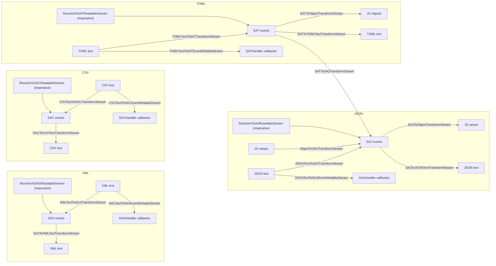

# simple-api-stream

Streaming utilities for **incremental JSON, XML, CSV, and TOML processing** built on the [Web Streams API](https://developer.mozilla.org/en-US/docs/Web/API/Web_Streams_API).

Text is parsed chunk by chunk into a flat sequence of **events**: SAJ (Simple API for JSON) for JSON, SAX (Simple API for XML) for XML, SAC (Simple API for CSV) for CSV, and SAT (Simple API for TOML) for TOML. You can consume the events directly, rebuild JavaScript objects from them, or turn them back into text. Because every component is a standard `ReadableStream` / `WritableStream` / `TransformStream`, the pieces compose with `pipeThrough()` / `pipeTo()` and respect backpressure.

- Zero external runtime dependencies
- Works anywhere Web Streams are available (Node.js, browsers, Deno, Bun, …)
- Ships ESM builds with TypeScript type definitions (also directly `require()`-able via Node.js's `require(esm)`, enabled by default since Node.js 22.12; `engines` targets Node.js `>= 24`)
- Modular npm workspaces monorepo: install only the format packages you need

---

## ⚡ Quick Start

```ts
import { JSONTextToSAJTransformStream, SAJToObjectTransformStream } from "@simple-api-stream/json";

const response = await fetch("https://example.com/data.json");
const objects = response.body!
  .pipeThrough(new TextDecoderStream())
  .pipeThrough(new JSONTextToSAJTransformStream())
  .pipeThrough(new SAJToObjectTransformStream());

for await (const obj of objects) {
  console.log(obj);
}
```

---

## 📦 Packages

| Package | Description |
|---------|-------------|
| [`@simple-api-stream/core`](./packages/core) | Core event classes (`SAEvent`, `StartDocumentEvent`, `EndDocumentEvent`, `ErrorEvent`, `CommentEvent`), parser interfaces (`SimpleApiParser`), and shared utilities |
| [`@simple-api-stream/json`](./packages/json) | Streaming JSON (SAJ) parser, object materializer, serializer, and imperative builder |
| [`@simple-api-stream/xml`](./packages/xml) | Streaming XML (SAX) parser, serializer, and imperative builder |
| [`@simple-api-stream/csv`](./packages/csv) | Streaming CSV (SAC) parser, serializer, and imperative builder |
| [`@simple-api-stream/toml`](./packages/toml) | Streaming TOML (SAT) parser, object materializer, serializer, imperative builder, and optional SAJ bridge (`@simple-api-stream/toml/json`) |

---

## 🧭 Overview

Every format follows the same streaming mental model:

- **`*TextToSA*TransformStream`** — parses text chunks into a stream of events.
- **`SA*To*TextTransformStream`** — serializes events back into text.
- **`ResolveToSA*ReadableStream`** — an imperative builder (`ReadableStream`) that *resolves* `*Resolver` method calls (e.g. `stream.startObject()`, `stream.key("a")`) into event chunks.
- **`*TextToSA*EventWritableStream`** — parses text and invokes callback hooks on a `SA*Handler`.

> **Note on object materializers:** JSON and TOML have a 1-to-1 JavaScript object representation and include `SAJToObjectTransformStream` / `ObjectToSAJTransformStream` / `SATToObjectTransformStream`. XML and CSV intentionally stay at the event layer in v1.1.0 because their JavaScript object shape depends on schema and use case (object/DOM converters are planned for the next release).



## ✨ Features

| Package | Class | Stream type | Input | Output |
|---------|-------|-------------|-------|--------|
| **`@simple-api-stream/json`** | [`JSONTextToSAJTransformStream`](./packages/json/src/JSONTextToSAJTransformStream.ts) | `TransformStream` | JSON text (`string` chunks) | [`SAJEventInterface`](./packages/json/src/event-interface/SAJEventInterface.ts) objects |
| | [`JSONTextToSAJEventWritableStream`](./packages/json/src/JSONTextToSAJEventWritableStream.ts) | `WritableStream` | JSON text (`string` chunks) | Calls a [`SAJHandler`](./packages/json/src/interface/SAJHandler.ts) |
| | [`SAJToObjectTransformStream<T>`](./packages/json/src/SAJToObjectTransformStream.ts) | `TransformStream` | SAJ events | JavaScript values of type `T` |
| | [`ObjectToSAJTransformStream<T>`](./packages/json/src/ObjectToSAJTransformStream.ts) | `TransformStream` | JavaScript values (incl. iterables / async iterables) | SAJ events |
| | [`SAJToJSONTextTransformStream`](./packages/json/src/SAJToJSONTextTransformStream.ts) | `TransformStream` | SAJ events | JSON text |
| | [`ResolveToSAJReadableStream`](./packages/json/src/ResolveToSAJReadableStream.ts) | `ReadableStream` | Method calls ([`SAJResolver`](./packages/json/src/interface/SAJResolver.ts)) | SAJ events |
| **`@simple-api-stream/xml`** | [`XMLTextToSAXTransformStream`](./packages/xml/src/XMLTextToSAXTransformStream.ts) | `TransformStream` | XML text (`string` chunks) | [`SAXEventInterface`](./packages/xml/src/event-interface/SAXEventInterface.ts) objects |
| | [`XMLTextToSAXEventWritableStream`](./packages/xml/src/XMLTextToSAXEventWritableStream.ts) | `WritableStream` | XML text (`string` chunks) | Calls a [`SAXHandler`](./packages/xml/src/interface/SAXHandler.ts) |
| | [`SAXToXMLTextTransformStream`](./packages/xml/src/SAXToXMLTextTransformStream.ts) | `TransformStream` | SAX events | XML text |
| | [`ResolveToSAXReadableStream`](./packages/xml/src/ResolveToSAXReadableStream.ts) | `ReadableStream` | Method calls ([`SAXResolver`](./packages/xml/src/interface/SAXResolver.ts)) | SAX events |
| **`@simple-api-stream/csv`** | [`CSVTextToSACTransformStream`](./packages/csv/src/CSVTextToSACTransformStream.ts) | `TransformStream` | CSV text (`string` chunks) | [`SACEventInterface`](./packages/csv/src/event-interface/SACEventInterface.ts) objects |
| | [`CSVTextToSACEventWritableStream`](./packages/csv/src/CSVTextToSACEventWritableStream.ts) | `WritableStream` | CSV text (`string` chunks) | Calls a [`SACHandler`](./packages/csv/src/interface/SACHandler.ts) |
| | [`SACToCSVTextTransformStream`](./packages/csv/src/SACToCSVTextTransformStream.ts) | `TransformStream` | SAC events | CSV text |
| | [`ResolveToSACReadableStream`](./packages/csv/src/ResolveToSACReadableStream.ts) | `ReadableStream` | Method calls ([`SACResolver`](./packages/csv/src/interface/SACResolver.ts)) | SAC events |
| **`@simple-api-stream/toml`** | [`TOMLTextToSATTransformStream`](./packages/toml/src/TOMLTextToSATTransformStream.ts) | `TransformStream` | TOML text (`string` chunks) | [`SATEventInterface`](./packages/toml/src/event-interface/SATEventInterface.ts) objects |
| | [`TOMLTextToSATEventWritableStream`](./packages/toml/src/TOMLTextToSATEventWritableStream.ts) | `WritableStream` | TOML text (`string` chunks) | Calls a [`SATHandler`](./packages/toml/src/interface/SATHandler.ts) |
| | [`SATToObjectTransformStream<T>`](./packages/toml/src/SATToObjectTransformStream.ts) | `TransformStream` | SAT events | JavaScript objects of type `T` |
| | [`SATToTOMLTextTransformStream`](./packages/toml/src/SATToTOMLTextTransformStream.ts) | `TransformStream` | SAT events | TOML text |
| | [`ResolveToSATReadableStream`](./packages/toml/src/ResolveToSATReadableStream.ts) | `ReadableStream` | Method calls ([`SATResolver`](./packages/toml/src/interface/SATResolver.ts)) | SAT events |
| | [`SATToSAJTransformStream`](./packages/toml/src/SATToSAJTransformStream.ts) (`./json`) | `TransformStream` | SAT events | SAJ events |

---

## 🚀 Installation

```bash
# Install JSON streaming utilities
npm install @simple-api-stream/json

# Install XML streaming utilities
npm install @simple-api-stream/xml

# Install CSV streaming utilities
npm install @simple-api-stream/csv

# Install TOML streaming utilities
npm install @simple-api-stream/toml
```

> `@simple-api-stream/core` is listed under `dependencies` of each format package and is installed automatically — you only need to install `@simple-api-stream/core` directly if you are building a custom format parser or importing the shared base event classes directly.

### Requirements

- **Runtime (`engines`)**: Node.js **>= 24** (see `engines` in `package.json`), or any runtime that supports Web Streams and async iteration of `ReadableStream`.
- **Module format**: ESM-only builds. In CommonJS projects, packages can also be loaded via `require()` using Node.js's `require(esm)` (enabled by default since Node.js 22.12).

```ts
// ESM
import { JSONTextToSAJTransformStream } from "@simple-api-stream/json";
// CommonJS
const { JSONTextToSAJTransformStream } = require("@simple-api-stream/json");
```

---

## 📦 Usage

### JSON text → JavaScript objects

```ts
import {
  JSONTextToSAJTransformStream,
  SAJToObjectTransformStream,
} from "@simple-api-stream/json";

const response = await fetch("https://example.com/data.json");

const objects = response.body!
  .pipeThrough(new TextDecoderStream())
  .pipeThrough(new JSONTextToSAJTransformStream())
  .pipeThrough(new SAJToObjectTransformStream<MyType>());

for await (const obj of objects) {
  console.log("Parsed object:", obj);
}
```

### Multiple JSON documents (e.g. JSON Lines / NDJSON)

```ts
const objects = textStream
  .pipeThrough(new JSONTextToSAJTransformStream({ multiple: true }))
  .pipeThrough(new SAJToObjectTransformStream({ multiple: true }));
```

### JSON text → handler callbacks

```ts
import { JSONTextToSAJEventWritableStream } from "@simple-api-stream/json";

await textStream.pipeTo(new JSONTextToSAJEventWritableStream({
  onKey: ({ key }) => console.log("key:", key),
  onValue: ({ type, value }) => console.log("value:", type, value),
  onError: (err) => console.error(err),
}));
```

All handler methods are optional.

### JavaScript values → SAJ events

```ts
import { ObjectToSAJTransformStream } from "@simple-api-stream/json";

const events = ReadableStream.from([{ a: [1, null] }])
  .pipeThrough(new ObjectToSAJTransformStream());
```

Arrays, plain objects, primitives, `null`, objects with `toJSON()` (such as `Date`), iterables (such as `Set` and generators), and async iterables (serialized as arrays) are supported. How unsupported values (`undefined`, `NaN`, `Infinity`, functions, `bigint`, symbols, …) are handled is controlled by the `unSupported` option.

### Building SAJ events imperatively

```ts
import { ResolveToSAJReadableStream } from "@simple-api-stream/json";

const stream = new ResolveToSAJReadableStream();
stream.startObject();
stream.key("name");
stream.value("string", "Alice");
stream.endObject();
stream.close(); // or use `using stream = new ResolveToSAJReadableStream()`

const events = await Array.fromAsync(stream);
```

### XML text → SAX events

```ts
import { XMLTextToSAXTransformStream } from "@simple-api-stream/xml";

const events = xmlTextStream.pipeThrough(new XMLTextToSAXTransformStream());

for await (const event of events) {
  if (event.name === "startElement")
    console.log(event.tagName, event.attrs);
}
```

### XML text → handler callbacks

```ts
import { XMLTextToSAXEventWritableStream } from "@simple-api-stream/xml";

await xmlTextStream.pipeTo(new XMLTextToSAXEventWritableStream({
  onStartElement: ({ tagName, attrs }) => console.log("start", tagName, attrs),
  onText: ({ text }) => console.log("text", text),
  onEndElement: ({ tagName }) => console.log("end", tagName),
  onError: (err) => console.error(err),
}));
```

### Building XML imperatively

```ts
import { ResolveToSAXReadableStream, SAXToXMLTextTransformStream } from "@simple-api-stream/xml";

const stream = new ResolveToSAXReadableStream();
const xmlText = stream.pipeThrough(new SAXToXMLTextTransformStream({ summarize: true }));

stream.startDocument();
stream.processingInstruction({ target: "xml", version: "1.0", encoding: "UTF-8" });
stream.startElement("a", { href: "https://example.com" });
stream.text("Hello & welcome");
stream.endElement("a");
stream.endDocument();
stream.close();

console.log((await Array.fromAsync(xmlText)).join(""));
// <?xml version="1.0" encoding="UTF-8" ?><a href="https://example.com">Hello &amp; welcome</a>
```

### CSV text → SAC events

```ts
import { CSVTextToSACTransformStream } from "@simple-api-stream/csv";

const events = csvTextStream.pipeThrough(new CSVTextToSACTransformStream({ header: true }));

for await (const event of events) {
  if (event.name === "column")
    console.log(event.index, event.header, event.value);
}
```

### CSV text → handler callbacks

```ts
import { CSVTextToSACEventWritableStream } from "@simple-api-stream/csv";

await csvTextStream.pipeTo(new CSVTextToSACEventWritableStream({
  onColumn: ({ index, header, value }) => console.log(index, header, value),
  onError: (err) => console.error(err),
}, { header: true }));
```

### Building CSV imperatively

```ts
import { ResolveToSACReadableStream, SACToCSVTextTransformStream } from "@simple-api-stream/csv";

const stream = new ResolveToSACReadableStream();
const csvText = stream.pipeThrough(new SACToCSVTextTransformStream({ summarize: "row" }));

stream.startDocument();
stream.startHeaderRow();
stream.column("id");
stream.column("name");
stream.endHeaderRow();
stream.startRecordRow();
stream.column("1");
stream.column("Alice, Bob");
stream.endRecordRow();
stream.endDocument();
stream.close();

console.log((await Array.fromAsync(csvText)).join(""));
// id,name\r\n1,"Alice, Bob"\r\n
```

### TOML text → JavaScript objects / JSON text

```ts
import { TOMLTextToSATTransformStream, SATToObjectTransformStream } from "@simple-api-stream/toml";
import { SATToSAJTransformStream } from "@simple-api-stream/toml/json";
import { SAJToJSONTextTransformStream } from "@simple-api-stream/json";

const objects = tomlTextStream
  .pipeThrough(new TOMLTextToSATTransformStream())
  .pipeThrough(new SATToObjectTransformStream());

const jsonText = tomlTextStream
  .pipeThrough(new TOMLTextToSATTransformStream())
  .pipeThrough(new SATToSAJTransformStream())
  .pipeThrough(new SAJToJSONTextTransformStream({ indent: 2 }));
```

---

## ⚙️ Options

### `JSONTextToSAJTransformStream(options?)`

| Option | Type | Default | Description |
|--------|------|---------|-------------|
| `skipDocument` | `boolean` | `false` | Do not emit `startDocument` / `endDocument` events. |
| `multiple` | `boolean \| "json-seq"` | `false` | Accept multiple top-level JSON values in one stream (`true`), or parse RFC 7464 JSON text sequences (`"json-seq"`, `\x1E`-delimited). When `false`, a second value is an error. |
| `errorToEvent` | `boolean` | `false` | Only available when `multiple: "json-seq"`. Emit an `error` event on parse error and recover at the next `\x1E` / `EOF` (`endDocument` → `startDocument`) instead of failing the stream. |
| `allowComments` | `boolean` | `false` | Allow JSONC line (`//`) and block (`/* ... */`) comments and emit `comment` events. |
| `allowTrailingCommas` | `boolean` | `false` | Allow trailing commas in objects and arrays. |
| `onParseBefore` / `onParseAfter` / `onParseLoopBefore` / `onParseLoopAfter` | `(status) => void` | – | Debug hooks that receive the internal parser status. |

`JSONTextToSAJEventWritableStream(handler, options?)` accepts `{ skipDocument?: boolean }` combined with `{ multiple?: boolean, errorToEvent?: never } | { multiple: "json-seq", errorToEvent?: boolean }` as `options`, and `onErrorEvent` plus the same debug hooks in its `handler` object.

### `SAJToObjectTransformStream(options?)`

| Option | Type | Default | Description |
|--------|------|---------|-------------|
| `multiple` | `boolean` | `false` | Accept multiple top-level values. When `false`, events after the first completed value are an error. |

### `ObjectToSAJTransformStream(options?)`

| Option | Type | Default | Description |
|--------|------|---------|-------------|
| `makeDocument` | `boolean` | `true` | Wrap each written value in `startDocument` / `endDocument`. |
| `unSupported` | `"ignore" \| "error" \| "null" \| (arg: { value, skip }) => unknown` | `"ignore"` | How to handle values that cannot be represented in JSON. `"ignore"` drops them (and their key), `"error"` errors the stream, `"null"` replaces them with `null`. A function can return a replacement value or return `skip` to drop the value. |

### `SAJToJSONTextTransformStream(options?)`

| Option | Type | Default | Description |
|--------|------|---------|-------------|
| `summarize` | `boolean \| "default" \| "normal" \| "document"` | `"default"` | Output granularity. `"default"` (`false`) emits one chunk per event, `"normal"` (`true`) emits one chunk per top-level JSON value, `"document"` emits one chunk per `startDocument` … `endDocument`. |
| `indent` | `number \| string` | – | Indentation per nesting level: a number of spaces or a string such as `"\t"`. |
| `lineBreak` | `string` | `"\n"` (when `indent` is set), `""` otherwise | Line break string used between lines. |
| `comments` | `boolean` | `false` | Emit `comment` events as JSONC comments (`// ...` or `/* ... */`). When `false`, `comment` events are omitted. |

### `XMLTextToSAXTransformStream(options?)` / `XMLTextToSAXEventWritableStream(handler, options?)`

| Option | Type | Default | Description |
|--------|------|---------|-------------|
| `skipDocument` | `boolean` | `false` | Do not emit `startDocument` / `endDocument` events. |
| `multiple` | `boolean` | `true` | Allow multiple root elements in one stream. When `false`, a second root element is an error. *(The default is planned to change to `false` in a future version.)* |

### `SAXToXMLTextTransformStream(options?)`

| Option | Type | Default | Description |
|--------|------|---------|-------------|
| `indent` | `number \| string` | – | Indentation per nesting level: a number of spaces or a string such as `"\t"`. |
| `lineBreak` | `string` | `""` | String appended after each output block (e.g. `"\n"`). |
| `summarize` | `boolean \| "default" \| "element" \| "document"` | `"default"` | Output granularity. `"default"` (`false`) emits one chunk per event, `"element"` emits one chunk per top-level element, `"document"` (`true`) emits one chunk per `startDocument` … `endDocument`. |

Text and attribute values are escaped automatically.

### `CSVTextToSACTransformStream(options?)` / `CSVTextToSACEventWritableStream(handler, options?)`

| Option | Type | Default | Description |
|--------|------|---------|-------------|
| `header` | `boolean \| string[]` | `false` | `true`: treat the first row as `startHeaderRow` / `endHeaderRow` and attach `header` names to subsequent `column` events. `string[]`: synthesize a header row from the given names. |
| `delimiter` | `string` | `","` | Single-character field delimiter (e.g. `"\t"` for TSV). |
| `quote` | `string` | `'"'` | Single-character quote character. |
| `skipDocument` | `boolean` | `false` | Do not emit `startDocument` / `endDocument` events. |
| `skipEmptyLines` | `boolean` | `false` | Skip empty lines instead of emitting a single empty-column row. |
| `stripBom` | `boolean` | `true` | Strip a leading UTF-8 BOM (`\uFEFF`) if present. |
| `onParseBefore` / `onParseAfter` / `onParseLoopBefore` / `onParseLoopAfter` | `(status) => void` | – | Debug hooks that receive the internal parser status. |

### `SACToCSVTextTransformStream(options?)`

| Option | Type | Default | Description |
|--------|------|---------|-------------|
| `delimiter` | `string` | `","` | Single-character field delimiter. |
| `quote` | `string` | `'"'` | Single-character quote character. |
| `lineBreak` | `string` | `"\r\n"` | Line break string appended after each row. |
| `quotePolicy` | `"minimal" \| "all"` | `"minimal"` | `"minimal"` quotes only fields containing delimiters, quotes, or line breaks; `"all"` quotes every field. |
| `summarize` | `boolean \| "default" \| "row" \| "document"` | `"default"` | Output granularity. `"default"` (`false`) emits one chunk per event, `"row"` emits one chunk per row, `"document"` (`true`) emits one chunk per `startDocument` … `endDocument`. |

### `TOMLTextToSATTransformStream(options?)` / `TOMLTextToSATEventWritableStream(handler, options?)`

| Option | Type | Default | Description |
|--------|------|---------|-------------|
| `skipDocument` | `boolean` | `false` | Do not emit `startDocument` / `endDocument` events. |
| `comments` | `boolean` | `false` | Emit `comment` events for `# ...` comments. |
| `onParseBefore` / `onParseAfter` / `onParseLoopBefore` / `onParseLoopAfter` | `(status) => void` | – | Debug hooks that receive the internal parser status. |

### `SATToTOMLTextTransformStream(options?)`

| Option | Type | Default | Description |
|--------|------|---------|-------------|
| `lineBreak` | `string` | `"\n"` | Line break string appended after each statement. |
| `comments` | `boolean` | `false` | Emit `comment` events as `# ...` lines. When `false`, `comment` events are omitted. |
| `summarize` | `boolean \| "default" \| "document"` | `"default"` | Output granularity. `"default"` (`false`) emits one chunk per event, `"document"` (`true`) emits one chunk per `startDocument` … `endDocument`. |

---

## 📜 Event Formats

Events are plain objects with a `name` discriminator, so they can be narrowed with `switch (event.name)` in TypeScript. Type definitions are exported as `eventInterfaces` and the event classes as `events` from `@simple-api-stream/json`, `@simple-api-stream/xml`, `@simple-api-stream/csv`, and `@simple-api-stream/toml`.

### Shared Core Events (`@simple-api-stream/core`)

| Event `name` | JSON (SAJ) | XML (SAX) | CSV (SAC) | TOML (SAT) |
|--------------|-----------|-----------|-----------|------------|
| `startDocument` / `endDocument` | Yes (`skipDocument` to omit) | Yes (`skipDocument` to omit) | Yes (`skipDocument` to omit) | Yes (`skipDocument` to omit) |
| `comment` | Opt-in (`allowComments: true`) | Yes (always) | – | Opt-in (`comments: true`) |
| `error` | Opt-in (`multiple: "json-seq"`, `errorToEvent: true`) | – | – | – |

### SAJ (Simple API for JSON)

| `name` | Extra fields |
|--------|--------------|
| `startDocument` | `kind: "json"` |
| `endDocument` | – |
| `error` | `error: unknown` (emitted when `multiple: "json-seq"` and `errorToEvent: true`) |
| `startObject` / `endObject` | – |
| `startArray` / `endArray` | – |
| `key` | `key: string` |
| `value` | `type: "string" \| "number" \| "boolean" \| "null"`, `value` |
| `comment` | `comment: string`, `style?: "line" \| "block"` (emitted when `allowComments: true`) |

Example for `{ "a": [1, null] }`:

```js
{ "name": "startDocument", "kind": "json" }
{ "name": "startObject" }
{ "name": "key", "key": "a" }
{ "name": "startArray" }
{ "name": "value", "type": "number", "value": 1 }
{ "name": "value", "type": "null", "value": null }
{ "name": "endArray" }
{ "name": "endObject" }
{ "name": "endDocument" }
```

### SAX (Simple API for XML)

| `name` | Extra fields |
|--------|--------------|
| `startDocument` | `kind: "xml"` |
| `endDocument` | – |
| `startElement` | `tagName`, `attrs: Record<string, string>`, `selfClosing: boolean` |
| `endElement` | `tagName` |
| `text` | `text` (numeric references and XML/HTML5 named entities are unescaped) |
| `cdata` | `cdata` |
| `comment` | `comment` (preserved verbatim without entity unescaping) |
| `doctype` | `root`, `dtdType?: "PUBLIC" \| "SYSTEM"`, `identifier?`, `uri?`, `declarations?: string[]` |
| `processingInstruction` | `target`, `data`; `<?xml …?>` additionally has `version`, `encoding`, `standalone`, and `<?xml-stylesheet …?>` has `type`, `href` |

Example for `<a href="https://example.com">Hello</a>`:

```js
{ "name": "startDocument", "kind": "xml" }
{ "name": "startElement", "tagName": "a", "attrs": { "href": "https://example.com" }, "selfClosing": false }
{ "name": "text", "text": "Hello" }
{ "name": "endElement", "tagName": "a" }
{ "name": "endDocument" }
```

A self-closing tag such as `<br/>` produces a `startElement` with `selfClosing: true` immediately followed by an `endElement`.

### SAC (Simple API for CSV)

| `name` | Extra fields |
|--------|--------------|
| `startDocument` | `kind: "csv"` |
| `endDocument` | – |
| `startHeaderRow` / `endHeaderRow` | – |
| `startRecordRow` / `endRecordRow` | – |
| `column` | `value: string`, `index?: number`, `header?: string`, `quoted?: boolean` |

Example for `id,name\n1,Alice` with `{ header: true }`:

```js
{ "name": "startDocument", "kind": "csv" }
{ "name": "startHeaderRow" }
{ "name": "column", "value": "id", "index": 0, "quoted": false }
{ "name": "column", "value": "name", "index": 1, "quoted": false }
{ "name": "endHeaderRow" }
{ "name": "startRecordRow" }
{ "name": "column", "value": "1", "index": 0, "header": "id", "quoted": false }
{ "name": "column", "value": "Alice", "index": 1, "header": "name", "quoted": false }
{ "name": "endRecordRow" }
{ "name": "endDocument" }
```

### SAT (Simple API for TOML)

| `name` | Extra fields |
|--------|--------------|
| `startDocument` | `kind: "toml"` |
| `endDocument` | – |
| `comment` | `comment: string` (emitted when `comments: true`) |
| `table` | `path: string[]` (`[a.b]`) |
| `arrayTable` | `path: string[]` (`[[a.b]]`) |
| `key` | `path: string[]` (`a.b = ...`) |
| `startArray` / `endArray` | – |
| `startInlineTable` / `endInlineTable` | – |
| `value` | `type: "string" \| "integer" \| "float" \| "boolean" \| "offsetDateTime" \| "localDateTime" \| "localDate" \| "localTime"`, `value` |

---

## ⚠️ Error Handling

- Malformed input errors the stream. With `TransformStream`s, both the readable side (e.g. `for await`) and pending writes reject.
- With the `*EventWritableStream` classes, errors are reported to the handler's `onError` callback.
- Errors carry a snapshot of the internal state for debugging (e.g. `buffer`, `state`, `pos`). The error classes are available from `streams` on `@simple-api-stream/json`, `@simple-api-stream/xml`, `@simple-api-stream/csv`, and `@simple-api-stream/toml`:

| Error class | Import from |
|-------------|-------------|
| `JSONTextToSAJParserError` | `@simple-api-stream/json` (`streams.JSONTextToSAJParserError`) |
| `SAJToObjectTransformStreamError` | `@simple-api-stream/json` (`streams.SAJToObjectTransformStreamError`) |
| `ObjectToSAJTransformStreamError` | `@simple-api-stream/json` (`streams.ObjectToSAJTransformStreamError`) |
| `SAJToJSONTextTransformStreamError` | `@simple-api-stream/json` (`streams.SAJToJSONTextTransformStreamError`) |
| `XMLTextToSAXParserError` | `@simple-api-stream/xml` (`streams.XMLTextToSAXParserError`) |
| `SAXToXMLTextTransformStreamError` | `@simple-api-stream/xml` (`streams.SAXToXMLTextTransformStreamError`) |
| `ResolveToSAXReadableStreamError` | `@simple-api-stream/xml` (`streams.ResolveToSAXReadableStreamError`) |
| `CSVTextToSACParserError` | `@simple-api-stream/csv` (`streams.CSVTextToSACParserError`) |
| `SACToCSVTextTransformStreamError` | `@simple-api-stream/csv` (`streams.SACToCSVTextTransformStreamError`) |
| `ResolveToSACReadableStreamError` | `@simple-api-stream/csv` (`streams.ResolveToSACReadableStreamError`) |
| `TOMLTextToSATParserError` | `@simple-api-stream/toml` (`streams.TOMLTextToSATParserError`) |
| `SATToTOMLTextTransformStreamError` | `@simple-api-stream/toml` (`streams.SATToTOMLTextTransformStreamError`) |
| `SATToObjectTransformStreamError` | `@simple-api-stream/toml` (`streams.SATToObjectTransformStreamError`) |

```ts
import { JSONTextToSAJTransformStream, streams } from "@simple-api-stream/json";

try {
  for await (const event of textStream.pipeThrough(new JSONTextToSAJTransformStream())) {
    // ...
  }
}
catch (e) {
  if (e instanceof streams.JSONTextToSAJParserError)
    console.error(e.message, e.state, e.pos);
}
```

---

## 📚 Exports

```ts
// Core contracts
import {
  SAEvent,
  StartDocumentEvent,
  EndDocumentEvent,
  ErrorEvent,
  CommentEvent,
  type SimpleApiParser,
  type StartDocumentSAEventInterface,
  type EndDocumentSAEventInterface,
  type ErrorSAEventInterface,
  type CommentSAEventInterface,
} from "@simple-api-stream/core";

// JSON streaming utilities
import {
  JSONTextToSAJTransformStream,
  JSONTextToSAJEventWritableStream,
  SAJToObjectTransformStream,
  ObjectToSAJTransformStream,
  SAJToJSONTextTransformStream,
  ResolveToSAJReadableStream,
  streams,
  events,
  type eventInterfaces,
  type interfaces,
} from "@simple-api-stream/json";

// XML streaming utilities
import {
  XMLTextToSAXTransformStream,
  XMLTextToSAXEventWritableStream,
  SAXToXMLTextTransformStream,
  ResolveToSAXReadableStream,
  streams,
  events,
  type eventInterfaces,
  type interfaces,
} from "@simple-api-stream/xml";

// CSV streaming utilities
import {
  CSVTextToSACTransformStream,
  CSVTextToSACEventWritableStream,
  SACToCSVTextTransformStream,
  ResolveToSACReadableStream,
  streams,
  events,
  type eventInterfaces,
  type interfaces,
} from "@simple-api-stream/csv";

// TOML streaming utilities
import {
  TOMLTextToSATTransformStream,
  TOMLTextToSATEventWritableStream,
  SATToObjectTransformStream,
  SATToTOMLTextTransformStream,
  ResolveToSATReadableStream,
  streams,
  events,
  type eventInterfaces,
  type interfaces,
} from "@simple-api-stream/toml";

// Optional TOML → JSON (SAT → SAJ) bridge
import { SATToSAJTransformStream } from "@simple-api-stream/toml/json";
```

---

## 🛠 Development

```bash
npm install
npm run lint     # ESLint (type-aware)
npm test         # Vitest with coverage across all packages
npm run build    # Build @simple-api-stream/{core,json,xml,csv,toml} (ESM + .d.ts)
```

- Packages live under `packages/core`, `packages/json`, `packages/xml`, `packages/csv`, and `packages/toml`; tests are colocated as `*.test.ts`.
- Relative imports use explicit `.js` extensions (`moduleResolution: "NodeNext"`).

## 📄 License

[MIT](./LICENSE)
