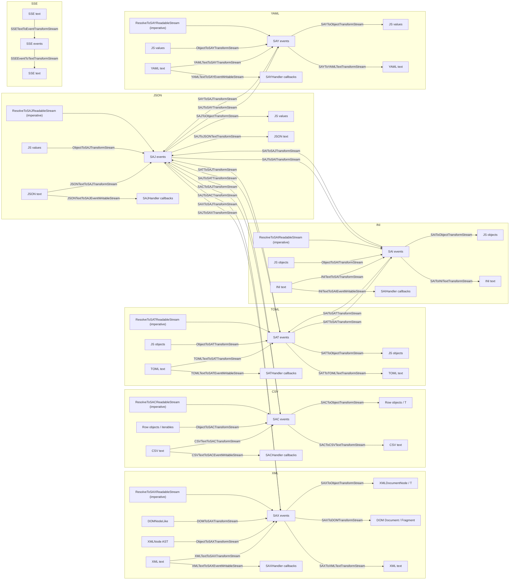

# simple-api-stream

Streaming utilities for **incremental JSON, XML, CSV, TOML, INI, YAML, and SSE processing** built on the [Web Streams API](https://developer.mozilla.org/en-US/docs/Web/API/Web_Streams_API).

Text is parsed chunk by chunk into a flat sequence of **events**: SAJ (Simple API for JSON) for JSON, SAX (Simple API for XML) for XML, SAC (Simple API for CSV) for CSV, SAT (Simple API for TOML) for TOML, SAI (Simple API for INI) for INI, SAY (Simple API for YAML) for YAML, and SSE events for Server-Sent Events (`text/event-stream`). You can consume the events directly, rebuild JavaScript objects from them, or turn them back into text. Because every component is a standard `ReadableStream` / `WritableStream` / `TransformStream`, the pieces compose with `pipeThrough()` / `pipeTo()` and respect backpressure.

- Zero external runtime dependencies
- Works anywhere Web Streams are available (Node.js, browsers, Deno, Bun, …)
- Ships ESM builds with TypeScript type definitions (also directly `require()`-able via Node.js's `require(esm)`, enabled by default since Node.js 22.12; `engines` targets Node.js `>= 24`)
- Modular npm workspaces monorepo: install only the format packages you need

---

## ⚡ Quick Start

```ts
import { parseJSONResponse } from "@simple-api-stream/json";

const response = await fetch("https://example.com/data.json");
for await (const obj of parseJSONResponse(response)) {
  console.log(obj);
}
```

Or compose the underlying Web Streams directly:

```ts
import { JSONTextToSAJTransformStream, SAJToObjectTransformStream } from "@simple-api-stream/json";

const response = await fetch("https://example.com/data.json");
const objects = response.body!
  .pipeThrough(new TextDecoderStream())
  .pipeThrough(new JSONTextToSAJTransformStream())
  .pipeThrough(new SAJToObjectTransformStream());

for await (const obj of objects) {
  console.log(obj);
}
```

---

## 📦 Packages

| Package | npm | Description |
|---------|-----|-------------|
| [`@simple-api-stream/core`](./packages/core) | [](https://www.npmjs.com/package/@simple-api-stream/core) | Core event classes (`SAEvent`, `StartDocumentEvent`, `EndDocumentEvent`, `ErrorEvent`, `CommentEvent`), parser interfaces (`SimpleApiParser`), and Fetch `Response` helpers (`responseToTextStream`, `ResponseStreamError`) |
| [`@simple-api-stream/json`](./packages/json) | [](https://www.npmjs.com/package/@simple-api-stream/json) | Streaming JSON (SAJ) parser, object materializer, serializer, imperative builder, and Fetch `Response` helper (`parseJSONResponse`) |
| [`@simple-api-stream/xml`](./packages/xml) | [](https://www.npmjs.com/package/@simple-api-stream/xml) | Streaming XML (SAX) parser, AST/DOM converters, serializer, imperative builder, Fetch `Response` helper (`parseXMLResponse`), and optional SAJ bridge (`@simple-api-stream/xml/json`) |
| [`@simple-api-stream/csv`](./packages/csv) | [](https://www.npmjs.com/package/@simple-api-stream/csv) | Streaming CSV (SAC) parser, row object converters, serializer, imperative builder, Fetch `Response` helper (`parseCSVResponse`), and optional SAJ bridge (`@simple-api-stream/csv/json`) |
| [`@simple-api-stream/toml`](./packages/toml) | [](https://www.npmjs.com/package/@simple-api-stream/toml) | Streaming TOML (SAT) parser, object converters, serializer, imperative builder, Fetch `Response` helper (`parseTOMLResponse`), and optional SAJ bridge (`@simple-api-stream/toml/json`) |
| [`@simple-api-stream/ini`](./packages/ini) | [](https://www.npmjs.com/package/@simple-api-stream/ini) | Streaming INI (SAI) parser, object converters, serializer, imperative builder, Fetch `Response` helper (`parseINIResponse`), and optional SAT/SAJ bridges (`@simple-api-stream/ini/toml`, `@simple-api-stream/ini/json`) |
| [`@simple-api-stream/yaml`](./packages/yaml) | [](https://www.npmjs.com/package/@simple-api-stream/yaml) | Streaming YAML 1.2 (SAY) parser, object converters (with anchors/aliases & merge keys), serializer, imperative builder, Fetch `Response` helper (`parseYAMLResponse`), and optional SAJ bridge (`@simple-api-stream/yaml/json`) |
| [`@simple-api-stream/sse`](./packages/sse) | [](https://www.npmjs.com/package/@simple-api-stream/sse) | Streaming Server-Sent Events (`text/event-stream`) parser, serializer, and Fetch `Response` helper (`parseSSEResponse`) |

All packages are published under the [@simple-api-stream](https://www.npmjs.com/org/simple-api-stream) npm organization.

---

## 🧭 Overview

Every document format (JSON, XML, CSV, TOML, INI, YAML) follows the same streaming mental model (while SSE focuses on line-oriented `message` / `comment` event streaming via `SSETextToEventTransformStream`, `SSEEventToTextTransformStream`, and `parseSSEResponse`):

- **`*TextToSA*TransformStream`** — parses text chunks into a stream of events.
- **`SA*To*TextTransformStream`** — serializes events back into text.
- **`SA*ToObjectTransformStream` / `ObjectToSA*TransformStream`** — converts between events and JavaScript values/objects (XML also provides `SAXToDOMTransformStream` / `DOMToSAXTransformStream` for DOM nodes).
- **`ResolveToSA*ReadableStream`** — an imperative builder (`ReadableStream`) that *resolves* `*Resolver` method calls (e.g. `stream.startObject()`, `stream.key("a")`) into event chunks.
- **`*TextToSA*EventWritableStream`** — parses text and invokes callback hooks on a `SA*Handler`.
- **`parse*Response`** — Fetch `Response` helpers built on `@simple-api-stream/core`'s `responseToTextStream()`.



## ✨ Features

| Package | Export | Type | Input | Output |
|---------|--------|------|-------|--------|
| **`@simple-api-stream/json`** | [`JSONTextToSAJTransformStream`](./packages/json/src/JSONTextToSAJTransformStream.ts) | `TransformStream` | JSON text (`string` chunks) | [`SAJEventInterface`](./packages/json/src/event-interface/SAJEventInterface.ts) objects |
| | [`JSONTextToSAJEventWritableStream`](./packages/json/src/JSONTextToSAJEventWritableStream.ts) | `WritableStream` | JSON text (`string` chunks) | Calls a [`SAJHandler`](./packages/json/src/interface/SAJHandler.ts) |
| | [`SAJToObjectTransformStream<T>`](./packages/json/src/SAJToObjectTransformStream.ts) | `TransformStream` | SAJ events | JavaScript values of type `T` |
| | [`ObjectToSAJTransformStream<T>`](./packages/json/src/ObjectToSAJTransformStream.ts) | `TransformStream` | JavaScript values (incl. iterables / async iterables) | SAJ events |
| | [`SAJToJSONTextTransformStream`](./packages/json/src/SAJToJSONTextTransformStream.ts) | `TransformStream` | SAJ events | JSON text |
| | [`ResolveToSAJReadableStream`](./packages/json/src/ResolveToSAJReadableStream.ts) | `ReadableStream` | Method calls ([`SAJResolver`](./packages/json/src/interface/SAJResolver.ts)) | SAJ events |
| | [`parseJSONResponse<T>`](./packages/json/src/parseJSONResponse.ts) | Helper function | Fetch `Response` | `ReadableStream<T>` (auto-detects NDJSON / JSONL / `json-seq`) |
| **`@simple-api-stream/xml`** | [`XMLTextToSAXTransformStream`](./packages/xml/src/XMLTextToSAXTransformStream.ts) | `TransformStream` | XML text (`string` chunks) | [`SAXEventInterface`](./packages/xml/src/event-interface/SAXEventInterface.ts) objects |
| | [`XMLTextToSAXEventWritableStream`](./packages/xml/src/XMLTextToSAXEventWritableStream.ts) | `WritableStream` | XML text (`string` chunks) | Calls a [`SAXHandler`](./packages/xml/src/interface/SAXHandler.ts) |
| | [`SAXToObjectTransformStream<T>`](./packages/xml/src/SAXToObjectTransformStream.ts) | `TransformStream` | SAX events | Lightweight XML AST (`XMLDocumentNode`) or mapped `T` |
| | [`ObjectToSAXTransformStream<T>`](./packages/xml/src/ObjectToSAXTransformStream.ts) | `TransformStream` | Lightweight XML AST (`XMLNode`) or mapped `T` | SAX events |
| | [`SAXToDOMTransformStream<T>`](./packages/xml/src/SAXToDOMTransformStream.ts) | `TransformStream` | SAX events | DOM `Document` or `DocumentFragment` |
| | [`DOMToSAXTransformStream`](./packages/xml/src/DOMToSAXTransformStream.ts) | `TransformStream` | DOM-like nodes (`DOMNodeLike`) | SAX events |
| | [`SAXToXMLTextTransformStream`](./packages/xml/src/SAXToXMLTextTransformStream.ts) | `TransformStream` | SAX events | XML text |
| | [`ResolveToSAXReadableStream`](./packages/xml/src/ResolveToSAXReadableStream.ts) | `ReadableStream` | Method calls ([`SAXResolver`](./packages/xml/src/interface/SAXResolver.ts)) | SAX events |
| | [`parseXMLResponse<T>`](./packages/xml/src/parseXMLResponse.ts) | Helper function | Fetch `Response` | `ReadableStream<T>` (`XMLDocumentNode` or mapped `T`) |
| | [`SAXToSAJTransformStream`](./packages/xml/src/json/SAXToSAJTransformStream.ts) (`./json`) | `TransformStream` | SAX events | SAJ events (`XMLDocumentNode` AST JSON) |
| | [`SAJToSAXTransformStream`](./packages/xml/src/json/SAJToSAXTransformStream.ts) (`./json`) | `TransformStream` | SAJ events (`XMLNode` AST JSON) | SAX events |
| **`@simple-api-stream/csv`** | [`CSVTextToSACTransformStream`](./packages/csv/src/CSVTextToSACTransformStream.ts) | `TransformStream` | CSV text (`string` chunks) | [`SACEventInterface`](./packages/csv/src/event-interface/SACEventInterface.ts) objects |
| | [`CSVTextToSACEventWritableStream`](./packages/csv/src/CSVTextToSACEventWritableStream.ts) | `WritableStream` | CSV text (`string` chunks) | Calls a [`SACHandler`](./packages/csv/src/interface/SACHandler.ts) |
| | [`SACToObjectTransformStream<T>`](./packages/csv/src/SACToObjectTransformStream.ts) | `TransformStream` | SAC events | JavaScript row objects / values of type `T` |
| | [`ObjectToSACTransformStream<T>`](./packages/csv/src/ObjectToSACTransformStream.ts) | `TransformStream` | JavaScript row objects / iterables | SAC events |
| | [`SACToCSVTextTransformStream`](./packages/csv/src/SACToCSVTextTransformStream.ts) | `TransformStream` | SAC events | CSV text |
| | [`ResolveToSACReadableStream`](./packages/csv/src/ResolveToSACReadableStream.ts) | `ReadableStream` | Method calls ([`SACResolver`](./packages/csv/src/interface/SACResolver.ts)) | SAC events |
| | [`parseCSVResponse<T>`](./packages/csv/src/parseCSVResponse.ts) | Helper function | Fetch `Response` | `ReadableStream<T>` (auto-sets `delimiter: "\t"` for TSV) |
| | [`SACToSAJTransformStream`](./packages/csv/src/json/SACToSAJTransformStream.ts) (`./json`) | `TransformStream` | SAC events | SAJ events (JSON array / NDJSON) |
| | [`SAJToSACTransformStream`](./packages/csv/src/json/SAJToSACTransformStream.ts) (`./json`) | `TransformStream` | SAJ events | SAC events |
| **`@simple-api-stream/toml`** | [`TOMLTextToSATTransformStream`](./packages/toml/src/TOMLTextToSATTransformStream.ts) | `TransformStream` | TOML text (`string` chunks) | [`SATEventInterface`](./packages/toml/src/event-interface/SATEventInterface.ts) objects |
| | [`TOMLTextToSATEventWritableStream`](./packages/toml/src/TOMLTextToSATEventWritableStream.ts) | `WritableStream` | TOML text (`string` chunks) | Calls a [`SATHandler`](./packages/toml/src/interface/SATHandler.ts) |
| | [`SATToObjectTransformStream<T>`](./packages/toml/src/SATToObjectTransformStream.ts) | `TransformStream` | SAT events | JavaScript objects of type `T` |
| | [`ObjectToSATTransformStream<T>`](./packages/toml/src/ObjectToSATTransformStream.ts) | `TransformStream` | JavaScript table objects | SAT events |
| | [`SATToTOMLTextTransformStream`](./packages/toml/src/SATToTOMLTextTransformStream.ts) | `TransformStream` | SAT events | TOML text |
| | [`ResolveToSATReadableStream`](./packages/toml/src/ResolveToSATReadableStream.ts) | `ReadableStream` | Method calls ([`SATResolver`](./packages/toml/src/interface/SATResolver.ts)) | SAT events |
| | [`parseTOMLResponse<T>`](./packages/toml/src/parseTOMLResponse.ts) | Helper function | Fetch `Response` | `ReadableStream<T>` (TOML table objects) |
| | [`SATToSAJTransformStream`](./packages/toml/src/json/SATToSAJTransformStream.ts) (`./json`) | `TransformStream` | SAT events | SAJ events |
| | [`SAJToSATTransformStream`](./packages/toml/src/json/SAJToSATTransformStream.ts) (`./json`) | `TransformStream` | SAJ events | SAT events |
| **`@simple-api-stream/ini`** | [`INITextToSAITransformStream`](./packages/ini/src/INITextToSAITransformStream.ts) | `TransformStream` | INI text (`string` chunks) | [`SAIEventInterface`](./packages/ini/src/event-interface/SAIEventInterface.ts) objects |
| | [`INITextToSAIEventWritableStream`](./packages/ini/src/INITextToSAIEventWritableStream.ts) | `WritableStream` | INI text (`string` chunks) | Calls a [`SAIHandler`](./packages/ini/src/interface/SAIHandler.ts) |
| | [`SAIToObjectTransformStream<T>`](./packages/ini/src/SAIToObjectTransformStream.ts) | `TransformStream` | SAI events | JavaScript objects of type `T` |
| | [`ObjectToSAITransformStream<T>`](./packages/ini/src/ObjectToSAITransformStream.ts) | `TransformStream` | JavaScript plain objects | SAI events |
| | [`SAIToINITextTransformStream`](./packages/ini/src/SAIToINITextTransformStream.ts) | `TransformStream` | SAI events | INI text |
| | [`ResolveToSAIReadableStream`](./packages/ini/src/ResolveToSAIReadableStream.ts) | `ReadableStream` | Method calls ([`SAIResolver`](./packages/ini/src/interface/SAIResolver.ts)) | SAI events |
| | [`parseINIResponse<T>`](./packages/ini/src/parseINIResponse.ts) | Helper function | Fetch `Response` | `ReadableStream<T>` (INI objects) |
| | [`SAIToSATTransformStream`](./packages/ini/src/toml/SAIToSATTransformStream.ts) (`./toml`) | `TransformStream` | SAI events | SAT events (O(1) streaming) |
| | [`SATToSAITransformStream`](./packages/ini/src/toml/SATToSAITransformStream.ts) (`./toml`) | `TransformStream` | SAT events | SAI events |
| | [`SAIToSAJTransformStream`](./packages/ini/src/json/SAIToSAJTransformStream.ts) (`./json`) | `TransformStream` | SAI events | SAJ events |
| | [`SAJToSAITransformStream`](./packages/ini/src/json/SAJToSAITransformStream.ts) (`./json`) | `TransformStream` | SAJ events | SAI events |
| **`@simple-api-stream/yaml`** | [`YAMLTextToSAYTransformStream`](./packages/yaml/src/YAMLTextToSAYTransformStream.ts) | `TransformStream` | YAML text (`string` chunks) | [`SAYEventInterface`](./packages/yaml/src/event-interface/SAYEventInterface.ts) objects |
| | [`YAMLTextToSAYEventWritableStream`](./packages/yaml/src/YAMLTextToSAYEventWritableStream.ts) | `WritableStream` | YAML text (`string` chunks) | Calls a [`SAYHandler`](./packages/yaml/src/interface/SAYHandler.ts) |
| | [`SAYToObjectTransformStream<T>`](./packages/yaml/src/SAYToObjectTransformStream.ts) | `TransformStream` | SAY events | JavaScript values of type `T` (resolves anchors/aliases & merge keys) |
| | [`ObjectToSAYTransformStream<T>`](./packages/yaml/src/ObjectToSAYTransformStream.ts) | `TransformStream` | JavaScript values | SAY events (optional auto-anchors) |
| | [`SAYToYAMLTextTransformStream`](./packages/yaml/src/SAYToYAMLTextTransformStream.ts) | `TransformStream` | SAY events | YAML text |
| | [`ResolveToSAYReadableStream`](./packages/yaml/src/ResolveToSAYReadableStream.ts) | `ReadableStream` | Method calls ([`SAYResolver`](./packages/yaml/src/interface/SAYResolver.ts)) | SAY events |
| | [`parseYAMLResponse<T>`](./packages/yaml/src/parseYAMLResponse.ts) | Helper function | Fetch `Response` | `ReadableStream<T>` (YAML values) |
| | [`SAYToSAJTransformStream`](./packages/yaml/src/json/SAYToSAJTransformStream.ts) (`./json`) | `TransformStream` | SAY events | SAJ events |
| | [`SAJToSAYTransformStream`](./packages/yaml/src/json/SAJToSAYTransformStream.ts) (`./json`) | `TransformStream` | SAJ events | SAY events (O(1) streaming) |
| **`@simple-api-stream/sse`** | [`SSETextToEventTransformStream`](./packages/sse/src/SSETextToEventTransformStream.ts) | `TransformStream` | SSE text (`string` chunks) | [`SSEEventInterface`](./packages/sse/src/event-interface/SSEEventInterface.ts) objects |
| | [`SSEEventToTextTransformStream`](./packages/sse/src/SSEEventToTextTransformStream.ts) | `TransformStream` | [`SSEEventInterface`](./packages/sse/src/event-interface/SSEEventInterface.ts) objects | SSE text (`text/event-stream`) |
| | [`parseSSEResponse<T>`](./packages/sse/src/parseSSEResponse.ts) | Helper function | Fetch `Response` | `ReadableStream<T>` (`SSEMessage` or mapped `T`) |

---

## 🚀 Installation

```bash
# Install JSON streaming utilities
npm install @simple-api-stream/json

# Install XML streaming utilities
npm install @simple-api-stream/xml

# Install CSV streaming utilities
npm install @simple-api-stream/csv

# Install TOML streaming utilities
npm install @simple-api-stream/toml

# Install INI streaming utilities
npm install @simple-api-stream/ini

# Install YAML streaming utilities
npm install @simple-api-stream/yaml

# Install Server-Sent Events (SSE) streaming utilities
npm install @simple-api-stream/sse
```

> `@simple-api-stream/core` is listed under `dependencies` of each format package and is installed automatically — you only need to install `@simple-api-stream/core` directly if you are building a custom format parser or importing the shared base event classes directly.

### Requirements

- **Runtime (`engines`)**: Node.js **>= 24** (see `engines` in `package.json`), or any runtime that supports Web Streams and async iteration of `ReadableStream`.
- **Module format**: ESM-only builds. In CommonJS projects, packages can also be loaded via `require()` using Node.js's `require(esm)` (enabled by default since Node.js 22.12).

```ts
// ESM
import { JSONTextToSAJTransformStream } from "@simple-api-stream/json";
// CommonJS
const { JSONTextToSAJTransformStream } = require("@simple-api-stream/json");
```

---

## 📦 Usage

### JSON text → JavaScript objects

```ts
import {
  JSONTextToSAJTransformStream,
  SAJToObjectTransformStream,
} from "@simple-api-stream/json";

const response = await fetch("https://example.com/data.json");

const objects = response.body!
  .pipeThrough(new TextDecoderStream())
  .pipeThrough(new JSONTextToSAJTransformStream())
  .pipeThrough(new SAJToObjectTransformStream<MyType>());

for await (const obj of objects) {
  console.log("Parsed object:", obj);
}
```

### Multiple JSON documents (e.g. JSON Lines / NDJSON)

```ts
const objects = textStream
  .pipeThrough(new JSONTextToSAJTransformStream({ multiple: true }))
  .pipeThrough(new SAJToObjectTransformStream({ multiple: true }));
```

### JSON text → handler callbacks

```ts
import { JSONTextToSAJEventWritableStream } from "@simple-api-stream/json";

await textStream.pipeTo(new JSONTextToSAJEventWritableStream({
  onKey: ({ key }) => console.log("key:", key),
  onValue: ({ type, value }) => console.log("value:", type, value),
  onError: (err) => console.error(err),
}));
```

All handler methods are optional.

### JavaScript values → SAJ events

```ts
import { ObjectToSAJTransformStream } from "@simple-api-stream/json";

const events = ReadableStream.from([{ a: [1, null] }])
  .pipeThrough(new ObjectToSAJTransformStream());
```

Arrays, plain objects, primitives, `null`, objects with `toJSON()` (such as `Date`), iterables (such as `Set` and generators), and async iterables (serialized as arrays) are supported. How unsupported values (`undefined`, `NaN`, `Infinity`, functions, `bigint`, symbols, …) are handled is controlled by the `unSupported` option.

### Building SAJ events imperatively

```ts
import { ResolveToSAJReadableStream } from "@simple-api-stream/json";

const stream = new ResolveToSAJReadableStream();
stream.startObject();
stream.key("name");
stream.value("string", "Alice");
stream.endObject();
stream.close(); // or use `using stream = new ResolveToSAJReadableStream()`

const events = await Array.fromAsync(stream);
```

### XML text → SAX events

```ts
import { XMLTextToSAXTransformStream } from "@simple-api-stream/xml";

const events = xmlTextStream.pipeThrough(new XMLTextToSAXTransformStream());

for await (const event of events) {
  if (event.name === "startElement")
    console.log(event.tagName, event.attrs);
}
```

### XML text → handler callbacks

```ts
import { XMLTextToSAXEventWritableStream } from "@simple-api-stream/xml";

await xmlTextStream.pipeTo(new XMLTextToSAXEventWritableStream({
  onStartElement: ({ tagName, attrs }) => console.log("start", tagName, attrs),
  onText: ({ text }) => console.log("text", text),
  onEndElement: ({ tagName }) => console.log("end", tagName),
  onError: (err) => console.error(err),
}));
```

### Building XML imperatively

```ts
import { ResolveToSAXReadableStream, SAXToXMLTextTransformStream } from "@simple-api-stream/xml";

const stream = new ResolveToSAXReadableStream();
const xmlText = stream.pipeThrough(new SAXToXMLTextTransformStream({ summarize: true }));

stream.startDocument();
stream.processingInstruction({ target: "xml", version: "1.0", encoding: "UTF-8" });
stream.startElement("a", { href: "https://example.com" });
stream.text("Hello & welcome");
stream.endElement("a");
stream.endDocument();
stream.close();

console.log((await Array.fromAsync(xmlText)).join(""));
// <?xml version="1.0" encoding="UTF-8" ?><a href="https://example.com">Hello &amp; welcome</a>
```

### XML text → AST / DOM → XML text

```ts
import {
  XMLTextToSAXTransformStream,
  SAXToObjectTransformStream,
  ObjectToSAXTransformStream,
  SAXToDOMTransformStream,
  DOMToSAXTransformStream,
  SAXToXMLTextTransformStream,
} from "@simple-api-stream/xml";

const docs = xmlTextStream
  .pipeThrough(new XMLTextToSAXTransformStream())
  .pipeThrough(new SAXToObjectTransformStream());

// Round-trip AST back to XML text
const xmlOut = docs
  .pipeThrough(new ObjectToSAXTransformStream())
  .pipeThrough(new SAXToXMLTextTransformStream({ summarize: "document" }));

// Or serialize a browser/jsdom/xmldom DOM node directly
const fromDom = domNodeStream
  .pipeThrough(new DOMToSAXTransformStream({ selfClosingEmptyElements: true }))
  .pipeThrough(new SAXToXMLTextTransformStream({ summarize: "document" }));
```

### CSV text → SAC events

```ts
import { CSVTextToSACTransformStream } from "@simple-api-stream/csv";

const events = csvTextStream.pipeThrough(new CSVTextToSACTransformStream({ header: true }));

for await (const event of events) {
  if (event.name === "column")
    console.log(event.index, event.header, event.value);
}
```

### CSV text → handler callbacks

```ts
import { CSVTextToSACEventWritableStream } from "@simple-api-stream/csv";

await csvTextStream.pipeTo(new CSVTextToSACEventWritableStream({
  onColumn: ({ index, header, value }) => console.log(index, header, value),
  onError: (err) => console.error(err),
}, { header: true }));
```

### Building CSV imperatively

```ts
import { ResolveToSACReadableStream, SACToCSVTextTransformStream } from "@simple-api-stream/csv";

const stream = new ResolveToSACReadableStream();
const csvText = stream.pipeThrough(new SACToCSVTextTransformStream({ summarize: "row" }));

stream.startDocument();
stream.startHeaderRow();
stream.column("id");
stream.column("name");
stream.endHeaderRow();
stream.startRecordRow();
stream.column("1");
stream.column("Alice, Bob");
stream.endRecordRow();
stream.endDocument();
stream.close();

console.log((await Array.fromAsync(csvText)).join(""));
// id,name\r\n1,"Alice, Bob"\r\n
```

### CSV text → row objects → CSV text

```ts
import {
  CSVTextToSACTransformStream,
  SACToObjectTransformStream,
  ObjectToSACTransformStream,
  SACToCSVTextTransformStream,
} from "@simple-api-stream/csv";

const rows = csvTextStream
  .pipeThrough(new CSVTextToSACTransformStream({ header: true }))
  .pipeThrough(new SACToObjectTransformStream({
    mapRow: ({ columns, skip }) => {
      if (columns[0]?.value === "") return skip;
      return { id: Number(columns[0]?.value), name: columns[1]?.value ?? "" };
    },
  }));

const csvOut = rows
  .pipeThrough(new ObjectToSACTransformStream({ header: ["id", "name"] }))
  .pipeThrough(new SACToCSVTextTransformStream({ summarize: "row" }));
```

### Fetch `Response` helpers

Each format package provides a `parse*Response(response, options?)` helper built on `@simple-api-stream/core`'s `responseToTextStream()`. They validate the `Content-Type` header by default (`checkContentType: false` to disable, or pass a `RegExp` / predicate), detect `charset` automatically, and return a `ReadableStream<T>` (which can be consumed with `for await` or piped further):

```ts
import { parseJSONResponse } from "@simple-api-stream/json";
import { parseXMLResponse } from "@simple-api-stream/xml";
import { parseCSVResponse } from "@simple-api-stream/csv";
import { parseTOMLResponse } from "@simple-api-stream/toml";
import { parseINIResponse } from "@simple-api-stream/ini";
import { parseYAMLResponse } from "@simple-api-stream/yaml";
import { parseSSEResponse } from "@simple-api-stream/sse";

// JSON (auto-enables multiple for NDJSON / JSONL / application/json-seq)
for await (const item of parseJSONResponse<MyType>(await fetch("/api/data.ndjson"))) {
  console.log(item);
}

// CSV (auto-sets delimiter: "\t" for text/tab-separated-values; infers T from mapRow)
for await (const row of parseCSVResponse(await fetch("/data.csv"), {
  parser: { header: true },
  object: { mapRow: ({ columns }) => ({ id: Number(columns[0]?.value), name: columns[1]?.value ?? "" }) },
})) {
  console.log(row.id, row.name);
}

// XML, TOML, INI & YAML
const xmlDocs = parseXMLResponse(await fetch("/feed.xml"));
const tomlConfigs = parseTOMLResponse(await fetch("/config.toml"), { checkOk: true });
const iniConfigs = parseINIResponse(await fetch("/config.ini"));
const yamlDocs = parseYAMLResponse(await fetch("/config.yaml"));

// SSE (validates text/event-stream; supports mapMessage + skip)
for await (const msg of parseSSEResponse(await fetch("/events"), {
  mapMessage: (m, { skip }) => (m.data === "[DONE]" ? skip : JSON.parse(m.data)),
})) {
  console.log(msg);
}
```

### TOML text → JavaScript objects / JSON text

```ts
import { TOMLTextToSATTransformStream, SATToObjectTransformStream } from "@simple-api-stream/toml";
import { SATToSAJTransformStream } from "@simple-api-stream/toml/json";
import { SAJToJSONTextTransformStream } from "@simple-api-stream/json";

const objects = tomlTextStream
  .pipeThrough(new TOMLTextToSATTransformStream())
  .pipeThrough(new SATToObjectTransformStream());

const jsonText = tomlTextStream
  .pipeThrough(new TOMLTextToSATTransformStream())
  .pipeThrough(new SATToSAJTransformStream())
  .pipeThrough(new SAJToJSONTextTransformStream({ indent: 2 }));
```

### INI text ⇔ TOML text

```ts
import { INITextToSAITransformStream } from "@simple-api-stream/ini";
import { SAIToSATTransformStream } from "@simple-api-stream/ini/toml";
import { SATToTOMLTextTransformStream } from "@simple-api-stream/toml";

const tomlText = iniTextStream
  .pipeThrough(new INITextToSAITransformStream({ comments: true }))
  .pipeThrough(new SAIToSATTransformStream())
  .pipeThrough(new SATToTOMLTextTransformStream({ comments: true }));
```

### YAML text → JavaScript values / JSON text

```ts
import { YAMLTextToSAYTransformStream, SAYToObjectTransformStream } from "@simple-api-stream/yaml";
import { SAYToSAJTransformStream } from "@simple-api-stream/yaml/json";
import { SAJToJSONTextTransformStream } from "@simple-api-stream/json";

const docs = yamlTextStream
  .pipeThrough(new YAMLTextToSAYTransformStream())
  .pipeThrough(new SAYToObjectTransformStream());

const yamlAsJson = yamlTextStream
  .pipeThrough(new YAMLTextToSAYTransformStream())
  .pipeThrough(new SAYToSAJTransformStream())
  .pipeThrough(new SAJToJSONTextTransformStream({ indent: 2 }));
```

### SSE text → events → SSE text

```ts
import {
  SSETextToEventTransformStream,
  SSEEventToTextTransformStream,
} from "@simple-api-stream/sse";

const events = sseTextStream.pipeThrough(new SSETextToEventTransformStream({ comments: true }));

// Or transform and serialize back to text/event-stream
const sseOut = events.pipeThrough(new SSEEventToTextTransformStream({ comments: true }));
```

---

## ⚙️ Options

### `JSONTextToSAJTransformStream(options?)`

| Option | Type | Default | Description |
|--------|------|---------|-------------|
| `skipDocument` | `boolean` | `false` | Do not emit `startDocument` / `endDocument` events. |
| `multiple` | `boolean \| "json-seq"` | `false` | Accept multiple top-level JSON values in one stream (`true`), or parse RFC 7464 JSON text sequences (`"json-seq"`, `\x1E`-delimited). When `false`, a second value is an error. |
| `errorToEvent` | `boolean` | `false` | Only available when `multiple: "json-seq"`. Emit an `error` event on parse error and recover at the next `\x1E` / `EOF` (`endDocument` → `startDocument`) instead of failing the stream. |
| `allowComments` | `boolean` | `false` | Allow JSONC line (`//`) and block (`/* ... */`) comments and emit `comment` events. |
| `allowTrailingCommas` | `boolean` | `false` | Allow trailing commas in objects and arrays. |
| `onParseBefore` / `onParseAfter` / `onParseLoopBefore` / `onParseLoopAfter` | `(status) => void` | – | Debug hooks that receive the internal parser status. |

`JSONTextToSAJEventWritableStream(handler, options?)` accepts `{ skipDocument?: boolean }` combined with `{ multiple?: boolean, errorToEvent?: never } | { multiple: "json-seq", errorToEvent?: boolean }` as `options`, and `onErrorEvent` plus the same debug hooks in its `handler` object.

### `SAJToObjectTransformStream(options?)`

| Option | Type | Default | Description |
|--------|------|---------|-------------|
| `multiple` | `boolean` | `false` | Accept multiple top-level values. When `false`, events after the first completed value are an error. |

### `ObjectToSAJTransformStream(options?)`

| Option | Type | Default | Description |
|--------|------|---------|-------------|
| `makeDocument` | `boolean` | `true` | Wrap each written value in `startDocument` / `endDocument`. |
| `unSupported` | `"ignore" \| "error" \| "null" \| (arg: { value, skip }) => unknown` | `"ignore"` | How to handle values that cannot be represented in JSON. `"ignore"` drops them (and their key), `"error"` errors the stream, `"null"` replaces them with `null`. A function can return a replacement value or return `skip` to drop the value. |

### `SAJToJSONTextTransformStream(options?)`

| Option | Type | Default | Description |
|--------|------|---------|-------------|
| `summarize` | `boolean \| "default" \| "normal" \| "document"` | `"default"` | Output granularity. `"default"` (`false`) emits one chunk per event, `"normal"` (`true`) emits one chunk per top-level JSON value, `"document"` emits one chunk per `startDocument` … `endDocument`. |
| `indent` | `number \| string` | – | Indentation per nesting level: a number of spaces or a string such as `"\t"`. |
| `lineBreak` | `string` | `"\n"` (when `indent` is set), `""` otherwise | Line break string used between lines. |
| `comments` | `boolean` | `false` | Emit `comment` events as JSONC comments (`// ...` or `/* ... */`). When `false`, `comment` events are omitted. |

### `XMLTextToSAXTransformStream(options?)` / `XMLTextToSAXEventWritableStream(handler, options?)`

| Option | Type | Default | Description |
|--------|------|---------|-------------|
| `skipDocument` | `boolean` | `false` | Do not emit `startDocument` / `endDocument` events. |
| `multiple` | `boolean` | `true` | Allow multiple root elements in one stream. When `false`, a second root element is an error. *(The default is planned to change to `false` in a future version.)* |

### `SAXToXMLTextTransformStream(options?)`

| Option | Type | Default | Description |
|--------|------|---------|-------------|
| `indent` | `number \| string` | – | Indentation per nesting level: a number of spaces or a string such as `"\t"`. |
| `lineBreak` | `string` | `""` | String appended after each output block (e.g. `"\n"`). |
| `summarize` | `boolean \| "default" \| "element" \| "document"` | `"default"` | Output granularity. `"default"` (`false`) emits one chunk per event, `"element"` emits one chunk per top-level element, `"document"` (`true`) emits one chunk per `startDocument` … `endDocument`. |

Text and attribute values are escaped automatically.

### `SAXToObjectTransformStream<T>(options?)`

| Option | Type | Default | Description |
|--------|------|---------|-------------|
| `mapDocument` | `(doc: XMLDocumentNode, ctx: { skip }) => T \| typeof skip` | – | Map each completed `XMLDocumentNode` to a custom value (infers `T`) or return `skip` to omit it. |
| `ignoreWhitespaceText` | `boolean` | `false` | Omit whitespace-only `text` events from the reconstructed tree. |
| `ignoreComments` | `boolean` | `false` | Omit `comment` events from the reconstructed tree. |

### `ObjectToSAXTransformStream<T>(options?)`

| Option | Type | Default | Description |
|--------|------|---------|-------------|
| `makeDocument` | `boolean` | `true` | Wrap each emitted top-level node in `startDocument` / `endDocument`. |
| `mapNode` | `(value: T, ctx: { skip }) => XMLNode \| typeof skip` | – | Map custom input values into `XMLNode` (or return `skip` to omit them). |

### `SAXToDOMTransformStream<T>(options?)`

| Option | Type | Default | Description |
|--------|------|---------|-------------|
| `document` | `DOMDocumentFactoryLike<T>` | `globalThis.document` | DOM `Document` factory used to construct nodes (browser `document`, `jsdom`, `happy-dom`, `linkedom`, `@xmldom/xmldom`, etc.). |
| `createDocument` | `boolean` | `true` | Create a new XML `Document` via `document.implementation.createDocument(null, null)` when available; otherwise build a `DocumentFragment`. |
| `ignoreWhitespaceText` | `boolean` | `false` | Omit whitespace-only `text` events. |
| `ignoreComments` | `boolean` | `false` | Omit `comment` events. |

### `DOMToSAXTransformStream(options?)`

| Option | Type | Default | Description |
|--------|------|---------|-------------|
| `makeDocument` | `boolean` | `true` | Wrap each emitted top-level DOM node in `startDocument` / `endDocument`. |
| `selfClosingEmptyElements` | `boolean` | `false` | Emit `selfClosing: true` for element nodes with no child nodes. |

### `CSVTextToSACTransformStream(options?)` / `CSVTextToSACEventWritableStream(handler, options?)`

| Option | Type | Default | Description |
|--------|------|---------|-------------|
| `header` | `boolean \| string[]` | `false` | `true`: treat the first row as `startHeaderRow` / `endHeaderRow` and attach `header` names to subsequent `column` events. `string[]`: synthesize a header row from the given names. |
| `delimiter` | `string` | `","` | Single-character field delimiter (e.g. `"\t"` for TSV). |
| `quote` | `string` | `'"'` | Single-character quote character. |
| `skipDocument` | `boolean` | `false` | Do not emit `startDocument` / `endDocument` events. |
| `skipEmptyLines` | `boolean` | `false` | Skip empty lines instead of emitting a single empty-column row. |
| `stripBom` | `boolean` | `true` | Strip a leading UTF-8 BOM (`\uFEFF`) if present. |
| `onParseBefore` / `onParseAfter` / `onParseLoopBefore` / `onParseLoopAfter` | `(status) => void` | – | Debug hooks that receive the internal parser status. |

### `SACToCSVTextTransformStream(options?)`

| Option | Type | Default | Description |
|--------|------|---------|-------------|
| `delimiter` | `string` | `","` | Single-character field delimiter. |
| `quote` | `string` | `'"'` | Single-character quote character. |
| `lineBreak` | `string` | `"\r\n"` | Line break string appended after each row. |
| `quotePolicy` | `"minimal" \| "all"` | `"minimal"` | `"minimal"` quotes only fields containing delimiters, quotes, or line breaks; `"all"` quotes every field. |
| `summarize` | `boolean \| "default" \| "row" \| "document"` | `"default"` | Output granularity. `"default"` (`false`) emits one chunk per event, `"row"` emits one chunk per row, `"document"` (`true`) emits one chunk per `startDocument` … `endDocument`. |

### `SACToObjectTransformStream<T>(options?)`

| Option | Type | Default | Description |
|--------|------|---------|-------------|
| `mapRow` | `({ columns, headers, rowIndex, skip }) => T \| typeof skip` | `SACToObjectTransformStream.toObject` | Map each record row's column events and metadata into `T` (infers `T`) or return `skip` to omit the row. Use `SACToObjectTransformStream.toArray` for `string[]` rows. |

### `ObjectToSACTransformStream<T>(options?)`

| Option | Type | Default | Description |
|--------|------|---------|-------------|
| `makeDocument` | `boolean` | `true` | Wrap the stream in `startDocument` / `endDocument`. |
| `header` | `boolean \| readonly string[]` | `false` | `readonly string[]`: explicit column order and header names. `true`: infer headers from the first object row's keys. |
| `emitHeader` | `boolean` | `true` when `header` is enabled, `false` otherwise | Emit `startHeaderRow` … `endHeaderRow` before the first record row (or on flush if explicit headers were given). |
| `mapRow` | `(row: T, { headers, rowIndex, skip }) => Iterable<ObjectToSACColumnInput> \| typeof skip` | – | Custom row-to-columns mapper (supports `{ value, header?, quoted? }` metadata and `skip`). |
| `formatValue` | `(value, { index, header, rowIndex }) => ObjectToSACColumnInput` | – | Custom cell serializer for default object/iterable mapping. |

### `TOMLTextToSATTransformStream(options?)` / `TOMLTextToSATEventWritableStream(handler, options?)`

| Option | Type | Default | Description |
|--------|------|---------|-------------|
| `skipDocument` | `boolean` | `false` | Do not emit `startDocument` / `endDocument` events. |
| `comments` | `boolean` | `false` | Emit `comment` events for `# ...` comments. |
| `onParseBefore` / `onParseAfter` / `onParseLoopBefore` / `onParseLoopAfter` | `(status) => void` | – | Debug hooks that receive the internal parser status. |

### `SATToTOMLTextTransformStream(options?)`

| Option | Type | Default | Description |
|--------|------|---------|-------------|
| `lineBreak` | `string` | `"\n"` | Line break string appended after each statement. |
| `comments` | `boolean` | `false` | Emit `comment` events as `# ...` lines. When `false`, `comment` events are omitted. |
| `summarize` | `boolean \| "default" \| "document"` | `"default"` | Output granularity. `"default"` (`false`) emits one chunk per event, `"document"` (`true`) emits one chunk per `startDocument` … `endDocument`. |

### `ObjectToSATTransformStream<T>(options?)`

| Option | Type | Default | Description |
|--------|------|---------|-------------|
| `makeDocument` | `boolean` | `true` | Wrap each written table object in `startDocument` / `endDocument`. |
| `unSupported` | `"ignore" \| "error" \| (arg: { value, skip }) => unknown` | `"ignore"` | How to handle values that cannot be represented in TOML (`null`, `undefined`, `function`, `symbol`, `bigint`, invalid `Date`). `"ignore"` omits them, `"error"` errors the stream, and a function can return a replacement value or `skip`. |

### `SSETextToEventTransformStream(options?)`

| Option | Type | Default | Description |
|--------|------|---------|-------------|
| `skipDocument` | `boolean` | `false` | Do not emit `startDocument` / `endDocument` events. |
| `comments` | `boolean` | `false` | Emit `comment` events for `: ...` comment lines. |
| `stripBom` | `boolean` | `true` | Strip a leading UTF-8 BOM (`\uFEFF`) at the start of the stream. |
| `flushIncomplete` | `boolean` | `false` | Dispatch a pending event with non-empty `data` buffer if the stream ends without a trailing blank line (`false` matches the WHATWG SSE specification). |

### `SSEEventToTextTransformStream(options?)`

| Option | Type | Default | Description |
|--------|------|---------|-------------|
| `lineBreak` | `string` | `"\n"` | Line break sequence used in serialized output. |
| `comments` | `boolean` | `false` | Serialize `comment` events as `: ...` lines. When `false`, `comment` events are omitted. |

### Optional `./json` Bridge Streams

- **`SAXToSAJTransformStream(options?)`** (`@simple-api-stream/xml/json`): `makeDocument?: boolean` (`true`), `ignoreWhitespaceText?: boolean` (`false`), `ignoreComments?: boolean` (`false`).
- **`SAJToSAXTransformStream(options?)`** (`@simple-api-stream/xml/json`): `makeDocument?: boolean` (`true`), `multiple?: boolean` (`false`).
- **`SACToSAJTransformStream(options?)`** (`@simple-api-stream/csv/json`): `rowFormat?: "auto" | "object" | "array"` (`"auto"`), `multiple?: boolean` (`false`), `makeDocument?: boolean` (`true`), `includeHeaderRow?: boolean` (`false`).
- **`SAJToSACTransformStream(options?)`** (`@simple-api-stream/csv/json`): `makeDocument?: boolean` (`true`), `header?: "auto" | boolean | readonly string[]` (`"auto"`), `emitHeader?: boolean`, `formatValue?: ObjectToSACValueFormatter`.
- **`SATToSAJTransformStream(options?)`** (`@simple-api-stream/toml/json`): `makeDocument?: boolean` (`true`).
- **`SAJToSATTransformStream(options?)`** (`@simple-api-stream/toml/json`): `multiple?: boolean` (`false`), plus `ObjectToSATTransformStreamOptions` (`makeDocument`, `unSupported`).

### `responseToTextStream(response, options?)` / `parse*Response(response, options?)`

| Option | Type | Default | Description |
|--------|------|---------|-------------|
| `checkOk` | `boolean` | `false` | Throw `ResponseStreamError` if `!response.ok`. |
| `checkContentType` | `boolean \| RegExp \| ((contentType: string \| null) => boolean)` | `true` (for `parse*Response`) | Validate the `Content-Type` header (`false` disables validation). |
| `encoding` | `string` | `charset` from `Content-Type`, or `"utf-8"` | Character encoding passed to `TextDecoderStream`. |
| `decoder` | `TextDecoderOptions` | – | Options forwarded to `TextDecoderStream` (`fatal`, `ignoreBOM`). |
| `parser` | Format-specific parser options | – | Available on all `parse*Response` helpers; forwarded to the underlying `*TextTo*TransformStream`. |
| `object` | Format-specific object options | – | Available on `parseJSONResponse`, `parseXMLResponse`, `parseCSVResponse`, and `parseYAMLResponse`; forwarded to `*ToObjectTransformStream`. |
| `mapMessage` | `(message: SSEMessage, ctx: { skip }) => T \| typeof skip` | – | Available on `parseSSEResponse`; maps each `SSEMessage` into `T` or returns `skip` to filter out messages (e.g. `"[DONE]"`). |

---

## 📜 Event Formats

Events are plain objects with a `name` discriminator, so they can be narrowed with `switch (event.name)` in TypeScript. Type definitions are exported as `eventInterfaces` and the event classes as `events` from `@simple-api-stream/json`, `@simple-api-stream/xml`, `@simple-api-stream/csv`, `@simple-api-stream/toml`, and `@simple-api-stream/sse`.

### Shared Core Events (`@simple-api-stream/core`)

| Event `name` | JSON (SAJ) | XML (SAX) | CSV (SAC) | TOML (SAT) | INI (SAI) | YAML (SAY) | SSE |
|--------------|-----------|-----------|-----------|------------|-----------|------------|-----|
| `startDocument` / `endDocument` | Yes (`skipDocument` to omit) | Yes (`skipDocument` to omit) | Yes (`skipDocument` to omit) | Yes (`skipDocument` to omit) | Yes (`skipDocument` to omit) | Yes (`skipDocument` to omit) | Yes (`skipDocument` to omit) |
| `comment` | Opt-in (`allowComments: true`) | Yes (always) | – | Opt-in (`comments: true`) | Opt-in (`comments: true`) | Opt-in (`comments: true`) | Opt-in (`comments: true`) |
| `error` | Opt-in (`multiple: "json-seq"`, `errorToEvent: true`) | – | – | – | – | – | – |

### SAJ (Simple API for JSON)

| `name` | Extra fields |
|--------|--------------|
| `startDocument` | `kind: "json"` |
| `endDocument` | – |
| `error` | `error: unknown` (emitted when `multiple: "json-seq"` and `errorToEvent: true`) |
| `startObject` / `endObject` | – |
| `startArray` / `endArray` | – |
| `key` | `key: string` |
| `value` | `type: "string" \| "number" \| "boolean" \| "null"`, `value` |
| `comment` | `comment: string`, `style?: "line" \| "block"` (emitted when `allowComments: true`) |

Example for `{ "a": [1, null] }`:

```js
{ "name": "startDocument", "kind": "json" }
{ "name": "startObject" }
{ "name": "key", "key": "a" }
{ "name": "startArray" }
{ "name": "value", "type": "number", "value": 1 }
{ "name": "value", "type": "null", "value": null }
{ "name": "endArray" }
{ "name": "endObject" }
{ "name": "endDocument" }
```

### SAX (Simple API for XML)

| `name` | Extra fields |
|--------|--------------|
| `startDocument` | `kind: "xml"` |
| `endDocument` | – |
| `startElement` | `tagName`, `attrs: Record<string, string>`, `selfClosing: boolean` |
| `endElement` | `tagName` |
| `text` | `text` (numeric references and XML/HTML5 named entities are unescaped) |
| `cdata` | `cdata` |
| `comment` | `comment` (preserved verbatim without entity unescaping) |
| `doctype` | `root`, `dtdType?: "PUBLIC" \| "SYSTEM"`, `identifier?`, `uri?`, `declarations?: string[]` |
| `processingInstruction` | `target`, `data`; `<?xml …?>` additionally has `version`, `encoding`, `standalone`, and `<?xml-stylesheet …?>` has `type`, `href` |

Example for `<a href="https://example.com">Hello</a>`:

```js
{ "name": "startDocument", "kind": "xml" }
{ "name": "startElement", "tagName": "a", "attrs": { "href": "https://example.com" }, "selfClosing": false }
{ "name": "text", "text": "Hello" }
{ "name": "endElement", "tagName": "a" }
{ "name": "endDocument" }
```

A self-closing tag such as `<br/>` produces a `startElement` with `selfClosing: true` immediately followed by an `endElement`.

### SAC (Simple API for CSV)

| `name` | Extra fields |
|--------|--------------|
| `startDocument` | `kind: "csv"` |
| `endDocument` | – |
| `startHeaderRow` / `endHeaderRow` | – |
| `startRecordRow` / `endRecordRow` | – |
| `column` | `value: string`, `index?: number`, `header?: string`, `quoted?: boolean` |

Example for `id,name\n1,Alice` with `{ header: true }`:

```js
{ "name": "startDocument", "kind": "csv" }
{ "name": "startHeaderRow" }
{ "name": "column", "value": "id", "index": 0, "quoted": false }
{ "name": "column", "value": "name", "index": 1, "quoted": false }
{ "name": "endHeaderRow" }
{ "name": "startRecordRow" }
{ "name": "column", "value": "1", "index": 0, "header": "id", "quoted": false }
{ "name": "column", "value": "Alice", "index": 1, "header": "name", "quoted": false }
{ "name": "endRecordRow" }
{ "name": "endDocument" }
```

### SAT (Simple API for TOML)

| `name` | Extra fields |
|--------|--------------|
| `startDocument` | `kind: "toml"` |
| `endDocument` | – |
| `comment` | `comment: string` (emitted when `comments: true`) |
| `table` | `path: string[]` (`[a.b]`) |
| `arrayTable` | `path: string[]` (`[[a.b]]`) |
| `key` | `path: string[]` (`a.b = ...`) |
| `startArray` / `endArray` | – |
| `startInlineTable` / `endInlineTable` | – |
| `value` | `type: "string" \| "integer" \| "float" \| "boolean" \| "offsetDateTime" \| "localDateTime" \| "localDate" \| "localTime"`, `value` |

### SAI (Simple API for INI)

| `name` | Extra fields |
|--------|--------------|
| `startDocument` | `kind: "ini"` |
| `endDocument` | – |
| `comment` | `comment: string`, `prefix?: string` (emitted when `comments: true`) |
| `section` | `section: string` (`[section]`) |
| `entry` | `key: string`, `value: string` (`key = value`) |

### SAY (Simple API for YAML)

| `name` | Extra fields |
|--------|--------------|
| `startDocument` | `kind: "yaml"` |
| `endDocument` | – |
| `comment` | `comment: string` (emitted when `comments: true`) |
| `startMapping` / `endMapping` | `flow?: boolean`, `anchor?: string`, `tag?: string` |
| `startSequence` / `endSequence` | `flow?: boolean`, `anchor?: string`, `tag?: string` |
| `key` | `key: string` |
| `scalar` | `type: "string" \| "number" \| "boolean" \| "null"`, `value`, `style?: "plain" \| "single" \| "double" \| "literal" \| "folded"`, `anchor?: string`, `tag?: string` |
| `alias` | `alias: string` |

### SSE (Server-Sent Events)

| `name` | Extra fields |
|--------|--------------|
| `startDocument` | `kind: "sse"` |
| `endDocument` | – |
| `comment` | `comment: string` (emitted when `comments: true`) |
| `message` | `data: string`, `event?: string`, `id?: string`, `retry?: number` |

Example for `event: update\nid: 42\ndata: hello\n\n`:

```js
{ "name": "startDocument", "kind": "sse" }
{ "name": "message", "event": "update", "id": "42", "data": "hello" }
{ "name": "endDocument" }
```

---

## ⚠️ Error Handling

- Malformed input errors the stream. With `TransformStream`s, both the readable side (e.g. `for await`) and pending writes reject.
- With the `*EventWritableStream` classes, errors are reported to the handler's `onError` callback.
- Errors carry a snapshot of the internal state for debugging (e.g. `buffer`, `state`, `pos`). The error classes are available from `@simple-api-stream/core`, `streams` on `@simple-api-stream/{json,xml,csv,toml}`, and the `./json` subpaths:

| Error class | Import from |
|-------------|-------------|
| `ResponseStreamError` | `@simple-api-stream/core` |
| `JSONTextToSAJParserError` | `@simple-api-stream/json` (`streams.JSONTextToSAJParserError`) |
| `SAJToObjectTransformStreamError` | `@simple-api-stream/json` (`streams.SAJToObjectTransformStreamError`) |
| `ObjectToSAJTransformStreamError` | `@simple-api-stream/json` (`streams.ObjectToSAJTransformStreamError`) |
| `SAJToJSONTextTransformStreamError` | `@simple-api-stream/json` (`streams.SAJToJSONTextTransformStreamError`) |
| `XMLTextToSAXParserError` | `@simple-api-stream/xml` (`streams.XMLTextToSAXParserError`) |
| `SAXToObjectTransformStreamError` | `@simple-api-stream/xml` (`streams.SAXToObjectTransformStreamError`) |
| `ObjectToSAXTransformStreamError` | `@simple-api-stream/xml` (`streams.ObjectToSAXTransformStreamError`) |
| `SAXToDOMTransformStreamError` | `@simple-api-stream/xml` (`streams.SAXToDOMTransformStreamError`) |
| `DOMToSAXTransformStreamError` | `@simple-api-stream/xml` (`streams.DOMToSAXTransformStreamError`) |
| `SAXToXMLTextTransformStreamError` | `@simple-api-stream/xml` (`streams.SAXToXMLTextTransformStreamError`) |
| `ResolveToSAXReadableStreamError` | `@simple-api-stream/xml` (`streams.ResolveToSAXReadableStreamError`) |
| `SAXToSAJTransformStreamError` | `@simple-api-stream/xml/json` |
| `CSVTextToSACParserError` | `@simple-api-stream/csv` (`streams.CSVTextToSACParserError`) |
| `SACToObjectTransformStreamError` | `@simple-api-stream/csv` (`streams.SACToObjectTransformStreamError`) |
| `ObjectToSACTransformStreamError` | `@simple-api-stream/csv` (`streams.ObjectToSACTransformStreamError`) |
| `SACToCSVTextTransformStreamError` | `@simple-api-stream/csv` (`streams.SACToCSVTextTransformStreamError`) |
| `ResolveToSACReadableStreamError` | `@simple-api-stream/csv` (`streams.ResolveToSACReadableStreamError`) |
| `SACToSAJTransformStreamError` | `@simple-api-stream/csv/json` |
| `TOMLTextToSATParserError` | `@simple-api-stream/toml` (`streams.TOMLTextToSATParserError`) |
| `SATToTOMLTextTransformStreamError` | `@simple-api-stream/toml` (`streams.SATToTOMLTextTransformStreamError`) |
| `SATToObjectTransformStreamError` | `@simple-api-stream/toml` (`streams.SATToObjectTransformStreamError`) |
| `ObjectToSATTransformStreamError` | `@simple-api-stream/toml` (`streams.ObjectToSATTransformStreamError`) |
| `INITextToSAIParserError` | `@simple-api-stream/ini` (`streams.INITextToSAIParserError`) |
| `SAIToINITextTransformStreamError` | `@simple-api-stream/ini` (`streams.SAIToINITextTransformStreamError`) |
| `SAIToObjectTransformStreamError` | `@simple-api-stream/ini` (`streams.SAIToObjectTransformStreamError`) |
| `ObjectToSAITransformStreamError` | `@simple-api-stream/ini` (`streams.ObjectToSAITransformStreamError`) |
| `SATToSAITransformStreamError` | `@simple-api-stream/ini/toml` |
| `YAMLTextToSAYParserError` | `@simple-api-stream/yaml` (`streams.YAMLTextToSAYParserError`) |
| `SAYToYAMLTextTransformStreamError` | `@simple-api-stream/yaml` (`streams.SAYToYAMLTextTransformStreamError`) |
| `SAYToObjectTransformStreamError` | `@simple-api-stream/yaml` (`streams.SAYToObjectTransformStreamError`) |
| `ObjectToSAYTransformStreamError` | `@simple-api-stream/yaml` (`streams.ObjectToSAYTransformStreamError`) |
| `SAYToSAJTransformStreamError` | `@simple-api-stream/yaml/json` |

```ts
import { JSONTextToSAJTransformStream, streams } from "@simple-api-stream/json";

try {
  for await (const event of textStream.pipeThrough(new JSONTextToSAJTransformStream())) {
    // ...
  }
}
catch (e) {
  if (e instanceof streams.JSONTextToSAJParserError)
    console.error(e.message, e.state, e.pos);
}
```

---

## 📚 Exports

```ts
// Core contracts
import {
  SAEvent,
  StartDocumentEvent,
  EndDocumentEvent,
  ErrorEvent,
  CommentEvent,
  responseToTextStream,
  ResponseStreamError,
  parseMediaType,
  extractCharset,
  type SimpleApiParser,
  type ContentTypeMatcher,
  type ResponseToTextStreamOptions,
  type StartDocumentSAEventInterface,
  type EndDocumentSAEventInterface,
  type ErrorSAEventInterface,
  type CommentSAEventInterface,
} from "@simple-api-stream/core";

// JSON streaming utilities
import {
  JSONTextToSAJTransformStream,
  JSONTextToSAJEventWritableStream,
  SAJToObjectTransformStream,
  ObjectToSAJTransformStream,
  SAJToJSONTextTransformStream,
  ResolveToSAJReadableStream,
  parseJSONResponse,
  streams,
  events,
  type eventInterfaces,
  type interfaces,
} from "@simple-api-stream/json";

// XML streaming utilities
import {
  XMLTextToSAXTransformStream,
  XMLTextToSAXEventWritableStream,
  SAXToObjectTransformStream,
  ObjectToSAXTransformStream,
  SAXToDOMTransformStream,
  DOMToSAXTransformStream,
  SAXToXMLTextTransformStream,
  ResolveToSAXReadableStream,
  parseXMLResponse,
  streams,
  events,
  type eventInterfaces,
  type interfaces,
  type XMLNode,
  type XMLDocumentNode,
  type DOMNodeLike,
} from "@simple-api-stream/xml";

// CSV streaming utilities
import {
  CSVTextToSACTransformStream,
  CSVTextToSACEventWritableStream,
  SACToObjectTransformStream,
  ObjectToSACTransformStream,
  SACToCSVTextTransformStream,
  ResolveToSACReadableStream,
  parseCSVResponse,
  streams,
  events,
  type eventInterfaces,
  type interfaces,
} from "@simple-api-stream/csv";

// TOML streaming utilities
import {
  TOMLTextToSATTransformStream,
  TOMLTextToSATEventWritableStream,
  SATToObjectTransformStream,
  ObjectToSATTransformStream,
  SATToTOMLTextTransformStream,
  ResolveToSATReadableStream,
  parseTOMLResponse,
  streams,
  events,
  type eventInterfaces,
  type interfaces,
} from "@simple-api-stream/toml";

// SSE streaming utilities
import {
  SSETextToEventTransformStream,
  SSEEventToTextTransformStream,
  parseSSEResponse,
  streams,
  events,
  type eventInterfaces,
  type SSEMessage,
} from "@simple-api-stream/sse";

// Optional XML ⇔ JSON (SAX ⇔ SAJ, lossless XMLNode AST structure) bridge
import { SAXToSAJTransformStream, SAJToSAXTransformStream } from "@simple-api-stream/xml/json";

// Optional CSV ⇔ JSON (SAC ⇔ SAJ) bridge
import { SACToSAJTransformStream, SAJToSACTransformStream } from "@simple-api-stream/csv/json";

// Optional TOML ⇔ JSON (SAT ⇔ SAJ) bridge
import { SATToSAJTransformStream, SAJToSATTransformStream } from "@simple-api-stream/toml/json";

// INI streaming utilities & optional TOML / JSON bridges
import {
  INITextToSAITransformStream,
  INITextToSAIEventWritableStream,
  SAIToObjectTransformStream,
  ObjectToSAITransformStream,
  SAIToINITextTransformStream,
  ResolveToSAIReadableStream,
  parseINIResponse,
} from "@simple-api-stream/ini";
import { SAIToSATTransformStream, SATToSAITransformStream } from "@simple-api-stream/ini/toml";
import { SAIToSAJTransformStream, SAJToSAITransformStream } from "@simple-api-stream/ini/json";

// YAML streaming utilities & optional JSON bridge
import {
  YAMLTextToSAYTransformStream,
  YAMLTextToSAYEventWritableStream,
  SAYToObjectTransformStream,
  ObjectToSAYTransformStream,
  SAYToYAMLTextTransformStream,
  ResolveToSAYReadableStream,
  parseYAMLResponse,
} from "@simple-api-stream/yaml";
import { SAYToSAJTransformStream, SAJToSAYTransformStream } from "@simple-api-stream/yaml/json";
```

---

## 🛠 Development

```bash
npm install
npm run lint       # ESLint (type-aware)
npm run typecheck  # TypeScript check across root and all workspaces
npm test           # Vitest with coverage across all packages
npm run build      # Build @simple-api-stream/{core,json,xml,csv,toml,ini,yaml,sse} (ESM + .d.ts)
```

- Packages live under `packages/core`, `packages/json`, `packages/xml`, `packages/csv`, `packages/toml`, `packages/ini`, `packages/yaml`, and `packages/sse`; tests are colocated as `*.test.ts`.
- Relative imports use explicit `.js` extensions (`moduleResolution: "NodeNext"`).

## 🔗 See Also

- **Web Platform**: [WHATWG Streams Standard](https://streams.spec.whatwg.org/), [WHATWG Fetch Standard](https://fetch.spec.whatwg.org/), [WHATWG Encoding Standard](https://encoding.spec.whatwg.org/)
- **JSON**: [RFC 8259 (JSON)](https://datatracker.ietf.org/doc/html/rfc8259), [RFC 7464 (JSON Text Sequences)](https://datatracker.ietf.org/doc/html/rfc7464), [RFC 8142 (GeoJSON Text Sequences)](https://datatracker.ietf.org/doc/html/rfc8142), [JSON Lines](https://jsonlines.org/), [NDJSON](https://github.com/ndjson/ndjson-spec)
- **XML**: [W3C XML 1.0 (Fifth Edition)](https://www.w3.org/TR/xml/), [W3C XML Stylesheet Processing Instruction](https://www.w3.org/TR/xml-stylesheet/), [WHATWG DOM Standard](https://dom.spec.whatwg.org/), [WHATWG HTML Named Character References](https://html.spec.whatwg.org/multipage/named-characters.html)
- **CSV**: [RFC 4180 (CSV)](https://datatracker.ietf.org/doc/html/rfc4180), [IANA `text/tab-separated-values`](https://www.iana.org/assignments/media-types/text/tab-separated-values)
- **TOML**: [TOML v1.0.0 Specification](https://toml.io/en/v1.0.0), [RFC 3339 (Date and Time on the Internet)](https://datatracker.ietf.org/doc/html/rfc3339)
- **INI**: [INI file (Wikipedia)](https://en.wikipedia.org/wiki/INI_file)
- **YAML**: [YAML 1.2.2 Specification](https://yaml.org/spec/1.2.2/), [YAML 1.2 Core Schema](https://yaml.org/spec/1.2.2/#103-core-schema), [RFC 9512 (`application/yaml`)](https://datatracker.ietf.org/doc/html/rfc9512)
- **SSE**: [WHATWG HTML Living Standard — Server-Sent Events](https://html.spec.whatwg.org/multipage/server-sent-events.html)

## 📄 License

[MIT](./LICENSE)
