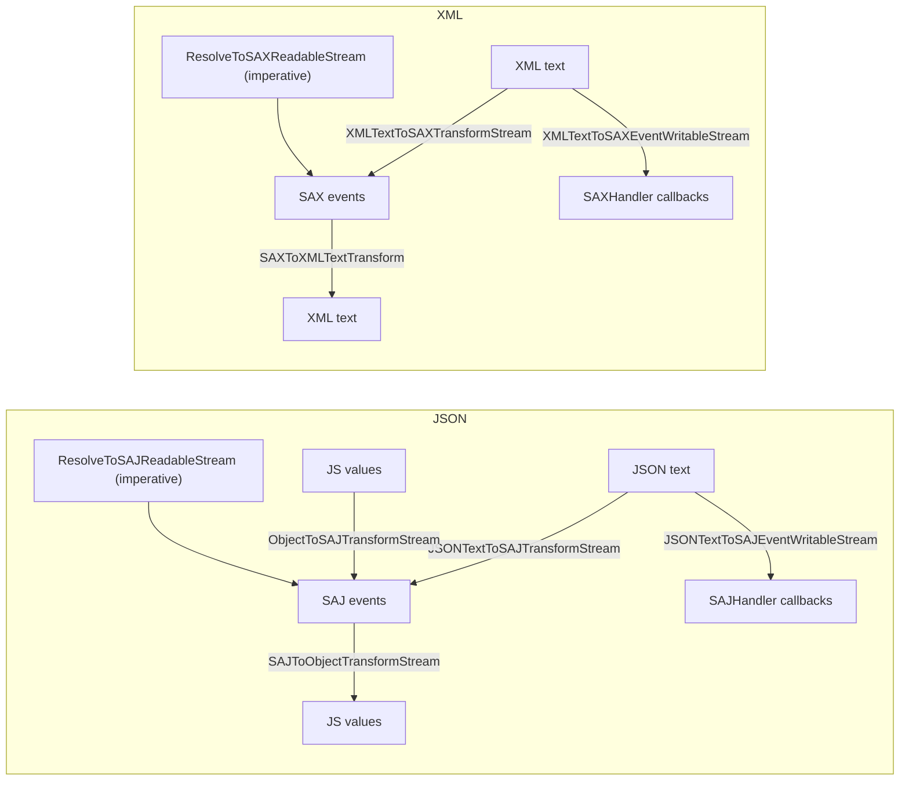

# simple-api-stream

Streaming utilities for **incremental JSON and XML processing** built on the [Web Streams API](https://developer.mozilla.org/en-US/docs/Web/API/Web_Streams_API).

Text is parsed chunk by chunk into a flat sequence of **events**: SAJ (Simple API for JSON) for JSON and SAX (Simple API for XML) for XML. You can consume the events directly, rebuild JavaScript objects from them, or turn them back into text. Because every component is a standard `ReadableStream` / `WritableStream` / `TransformStream`, the pieces compose with `pipeThrough()` / `pipeTo()` and respect backpressure.

- Zero runtime dependencies
- Works anywhere Web Streams are available (Node.js, browsers, Deno, Bun, …)
- Ships ESM build (directly `require()`-able in Node.js >= 24) with TypeScript type definitions

---

## 🧭 Overview



## ✨ Features

| Module | Class (root export) | Stream type | Input | Output |
|--------|---------------------|-------------|-------|--------|
| **JSON** | [`JSONTextToSAJTransformStream`](./src/json/JSONTextToSAJTransformStream.ts) | `TransformStream` | JSON text (`string` chunks) | [`SAJEventInterface`](./src/json/event-interface/SAJEventInterface.ts) objects |
| | [`JSONTextToSAJEventWritableStream`](./src/json/JSONTextToSAJEventWritableStream.ts) | `WritableStream` | JSON text (`string` chunks) | Calls a [`SAJHandler`](./src/json/interface/SAJHandler.ts) |
| | [`SAJToObjectTransformStream<T>`](./src/json/SAJToObjectTransformStream.ts) | `TransformStream` | SAJ events | JavaScript values of type `T` |
| | [`ObjectToSAJTransformStream<T>`](./src/json/ObjectToSAJTransformStream.ts) | `TransformStream` | JavaScript values (incl. iterators / async iterators) | SAJ events |
| | [`ResolveToSAJReadableStream`](./src/json/ResolveToSAJReadableStream.ts) | `ReadableStream` | Method calls ([`SAJResolver`](./src/json/interface/SAJResolver.ts)) | SAJ events |
| **XML** | [`XMLTextToSAXTransformStream`](./src/xml/XMLTextToSAXTransformStream.ts) | `TransformStream` | XML text (`string` chunks) | [`SAXEventInterface`](./src/xml/event-interface/SAXEventInterface.ts) objects |
| | [`XMLTextToSAXEventWritableStream`](./src/xml/XMLTextToSAXEventWritableStream.ts) | `WritableStream` | XML text (`string` chunks) | Calls a [`SAXHandler`](./src/xml/interface/SAXHandler.ts) |
| | [`SAXToXMLTextTransform`](./src/xml/SAXToXMLTextTransformStream.ts) | `TransformStream` | SAX events | XML text |
| | [`ResolveToSAXReadableStream`](./src/xml/ResolveToSAXReadableStream.ts) | `ReadableStream` | Method calls ([`SAXResolver`](./src/xml/interface/SAXResolver.ts)) | SAX events |

---

## 🚀 Installation

```bash
npm install simple-api-stream
```

### Requirements

- Node.js **>= 24** (see `engines` in `package.json`), or any runtime that supports Web Streams and async iteration of `ReadableStream`.

```ts
// ESM
import { JSONTextToSAJTransformStream } from "simple-api-stream";
// CommonJS
const { JSONTextToSAJTransformStream } = require("simple-api-stream");
```

---

## 📦 Usage

### JSON text → JavaScript objects

```ts
import {
  JSONTextToSAJTransformStream,
  SAJToObjectTransformStream,
} from "simple-api-stream";

const response = await fetch("https://example.com/data.json");

const objects = response.body!
  .pipeThrough(new TextDecoderStream())
  .pipeThrough(new JSONTextToSAJTransformStream())
  .pipeThrough(new SAJToObjectTransformStream<MyType>());

for await (const obj of objects) {
  console.log("Parsed object:", obj);
}
```

### Multiple JSON documents (e.g. JSON Lines / NDJSON)

```ts
const objects = textStream
  .pipeThrough(new JSONTextToSAJTransformStream({ multiple: true }))
  .pipeThrough(new SAJToObjectTransformStream({ multiple: true }));
```

### JSON text → handler callbacks

```ts
import { JSONTextToSAJEventWritableStream } from "simple-api-stream";

await textStream.pipeTo(new JSONTextToSAJEventWritableStream({
  onKey: ({ key }) => console.log("key:", key),
  onValue: ({ type, value }) => console.log("value:", type, value),
  onError: (err) => console.error(err),
}));
```

All handler methods are optional.

### JavaScript values → SAJ events

```ts
import { ObjectToSAJTransformStream } from "simple-api-stream";

const events = ReadableStream.from([{ a: [1, null] }])
  .pipeThrough(new ObjectToSAJTransformStream());
```

Arrays, plain objects, primitives, `null`, iterators and async iterators (serialized as arrays) are supported. How unsupported values (`undefined`, functions, `bigint`, symbols, …) are handled is controlled by the `unSupported` option.

### Building SAJ events imperatively

```ts
import { ResolveToSAJReadableStream } from "simple-api-stream";

const stream = new ResolveToSAJReadableStream();
stream.startObject();
stream.key("name");
stream.value("string", "Alice");
stream.endObject();
stream.close(); // or use `using stream = new ResolveToSAJReadableStream()`

const events = await Array.fromAsync(stream);
```

### XML text → SAX events

```ts
import { XMLTextToSAXTransformStream } from "simple-api-stream";

const events = xmlTextStream.pipeThrough(new XMLTextToSAXTransformStream());

for await (const event of events) {
  if (event.name === "startElement")
    console.log(event.tagName, event.attrs);
}
```

### XML text → handler callbacks

```ts
import { XMLTextToSAXEventWritableStream } from "simple-api-stream";

await xmlTextStream.pipeTo(new XMLTextToSAXEventWritableStream({
  onStartElement: ({ tagName, attrs }) => console.log("start", tagName, attrs),
  onText: ({ text }) => console.log("text", text),
  onEndElement: ({ tagName }) => console.log("end", tagName),
  onError: (err) => console.error(err),
}));
```

### Building XML imperatively

```ts
import { ResolveToSAXReadableStream, SAXToXMLTextTransform } from "simple-api-stream";

const stream = new ResolveToSAXReadableStream();
const xmlText = stream.pipeThrough(new SAXToXMLTextTransform({ summarize: true }));

stream.startDocument();
stream.processingInstruction({ target: "xml", version: "1.0", encoding: "UTF-8" });
stream.startElement("a", { href: "https://example.com" });
stream.text("Hello & welcome");
stream.endElement("a");
stream.endDocument();
stream.close();

console.log((await Array.fromAsync(xmlText)).join(""));
// <?xml version="1.0" encoding="UTF-8" ?><a href="https://example.com">Hello &amp; welcome</a>
```

---

## ⚙️ Options

### `JSONTextToSAJTransformStream(options?)`

| Option | Type | Default | Description |
|--------|------|---------|-------------|
| `skipDocument` | `boolean` | `false` | Do not emit `startDocument` / `endDocument` events. |
| `multiple` | `boolean` | `false` | Accept multiple top-level JSON values in one stream. When `false`, a second value is an error. |
| `onParseBefore` / `onParseAfter` / `onParseRoopBefore` / `onParseRoopAfter` | `(status) => void` | – | Debug hooks that receive the internal parser status. |

`JSONTextToSAJEventWritableStream(handler)` accepts the same debug hooks in its handler object.

### `SAJToObjectTransformStream(options?)`

| Option | Type | Default | Description |
|--------|------|---------|-------------|
| `multiple` | `boolean` | `false` | Accept multiple top-level values. When `false`, events after the first completed value are an error. |

### `ObjectToSAJTransformStream(options?)`

| Option | Type | Default | Description |
|--------|------|---------|-------------|
| `makeDocument` | `boolean` | `true` | Wrap each written value in `startDocument` / `endDocument`. |
| `unSupported` | `"ignore" \| "error" \| "null" \| (arg: { value, skip }) => unknown` | `"ignore"` | How to handle values that cannot be represented in JSON. `"ignore"` drops them (and their key), `"error"` errors the stream, `"null"` replaces them with `null`. A function can return a replacement value or return `skip` to drop the value. |

### `XMLTextToSAXTransformStream(options?)` / `XMLTextToSAXEventWritableStream(handler, options?)`

| Option | Type | Default | Description |
|--------|------|---------|-------------|
| `skipDocument` | `boolean` | `false` | Do not emit `startDocument` / `endDocument` events. |

### `SAXToXMLTextTransform(options?)`

| Option | Type | Default | Description |
|--------|------|---------|-------------|
| `indent` | `number \| string` | – | Indentation per nesting level: a number of spaces or a string such as `"\t"`. |
| `lineBreak` | `string` | `""` | String appended after each output block (e.g. `"\n"`). |
| `summarize` | `boolean \| "default" \| "element" \| "document"` | `"default"` | Output granularity. `"default"` (`false`) emits one chunk per event, `"element"` emits one chunk per top-level element, `"document"` (`true`) emits one chunk per `startDocument` … `endDocument`. |

Text and attribute values are escaped automatically.

---

## 📜 Event Formats

Events are plain objects with a `name` discriminator, so they can be narrowed with `switch (event.name)` in TypeScript. Type definitions are exported as `eventInterfaces` and the event classes as `events` from `simple-api-stream/json` and `simple-api-stream/xml`.

### SAJ (Simple API for JSON)

| `name` | Extra fields |
|--------|--------------|
| `startDocument` | `kind: "json"` |
| `endDocument` | – |
| `startObject` / `endObject` | – |
| `startArray` / `endArray` | – |
| `key` | `key: string` |
| `value` | `type: "string" \| "number" \| "boolean" \| "null"`, `value` |

Example for `{ "a": [1, null] }`:

```js
{ "name": "startDocument", "kind": "json" }
{ "name": "startObject" }
{ "name": "key", "key": "a" }
{ "name": "startArray" }
{ "name": "value", "type": "number", "value": 1 }
{ "name": "value", "type": "null", "value": null }
{ "name": "endArray" }
{ "name": "endObject" }
{ "name": "endDocument" }
```

### SAX (Simple API for XML)

| `name` | Extra fields |
|--------|--------------|
| `startDocument` | `kind: "xml"` |
| `endDocument` | – |
| `startElement` | `tagName`, `attrs: Record<string, string>`, `selfClosing: boolean` |
| `endElement` | `tagName` |
| `text` | `text` (entities are unescaped) |
| `cdata` | `cdata` |
| `comment` | `comment` |
| `doctype` | `root`, `dtdType?: "PUBLIC" \| "SYSTEM"`, `identifer?`, `uri?`, `declarations?: string[]` |
| `processingInstruction` | `target`, `data`; `<?xml …?>` additionally has `version`, `encoding`, `standalone`, and `<?xml-stylesheet …?>` has `type`, `href` |

Example for `<a href="https://example.com">Hello</a>`:

```js
{ "name": "startDocument", "kind": "xml" }
{ "name": "startElement", "tagName": "a", "attrs": { "href": "https://example.com" }, "selfClosing": false }
{ "name": "text", "text": "Hello" }
{ "name": "endElement", "tagName": "a" }
{ "name": "endDocument" }
```

A self-closing tag such as `<br/>` produces a `startElement` with `selfClosing: true` immediately followed by an `endElement`.

---

## ⚠️ Error Handling

- Malformed input errors the stream. With `TransformStream`s, both the readable side (e.g. `for await`) and pending writes reject.
- With the `*EventWritableStream` classes, errors are reported to the handler's `onError` callback.
- Errors carry a snapshot of the internal state for debugging (e.g. `buffer`, `state`, `pos`). The error classes are available from `streams` on `simple-api-stream/json` and `simple-api-stream/xml`:

| Error class | Import from |
|-------------|-------------|
| `JSONTextToSAJParserError` | `simple-api-stream/json` (`streams.JSONTextToSAJParserError`) |
| `SAJToObjectTransformStreamError` | `simple-api-stream/json` (`streams.SAJToObjectTransformStreamError`) |
| `ObjectToSAJTransformStreamError` | `simple-api-stream/json` (`streams.ObjectToSAJTransformStreamError`) |
| `XMLTextToSAXParserError` | `simple-api-stream/xml` (`streams.XMLTextToSAXParserError`) |
| `SAXToXMLTextTransformStreamError` | `simple-api-stream/xml` (`streams.SAXToXMLTextTransformStreamError`) |
| `ResolveToSAXReadableStreamError` | `simple-api-stream/xml` (`streams.ResolveToSAXReadableStreamError`) |

```ts
import { JSONTextToSAJTransformStream, streams } from "simple-api-stream/json";

try {
  for await (const event of textStream.pipeThrough(new JSONTextToSAJTransformStream())) {
    // ...
  }
}
catch (e) {
  if (e instanceof streams.JSONTextToSAJParserError)
    console.error(e.message, e.state, e.pos);
}
```

---

## 📚 Exports

You can import everything from the root entry point, or import only JSON / XML via subpath exports:

```ts
// Root entry point
import {
  // JSON
  JSONTextToSAJTransformStream,
  JSONTextToSAJEventWritableStream,
  SAJToObjectTransformStream,
  ObjectToSAJTransformStream,
  ResolveToSAJReadableStream,
  // XML
  XMLTextToSAXTransformStream,
  XMLTextToSAXEventWritableStream,
  SAXToXMLTextTransform,
  ResolveToSAXReadableStream,
  // Common types
  interfaces,
} from "simple-api-stream";

// Subpath entry points (tree-shakeable / load only what you need)
import {
  JSONTextToSAJTransformStream,
  SAJToObjectTransformStream,
  // also: JSONTextToSAJEventWritableStream, ObjectToSAJTransformStream, ResolveToSAJReadableStream,
  //       streams, events, eventInterfaces (types), interfaces (types)
} from "simple-api-stream/json";

import {
  XMLTextToSAXTransformStream,
  SAXToXMLTextTransform,
  // also: XMLTextToSAXEventWritableStream, ResolveToSAXReadableStream,
  //       streams, events, eventInterfaces (types), interfaces (types)
} from "simple-api-stream/xml";
```

End users should import from `simple-api-stream`, `simple-api-stream/json`, or `simple-api-stream/xml`, not from internal source paths.

---

## 🛠 Development

```bash
npm install
npm run lint     # ESLint (type-aware)
npm test         # Vitest with coverage
npm run build    # Vite bundle (ESM) and type declarations
```

- Source lives in `src/json` and `src/xml`; tests are colocated as `*.test.ts`.
- Relative imports use explicit `.js` extensions (`moduleResolution: "NodeNext"`).

## 📄 License

[MIT](./LICENSE)
